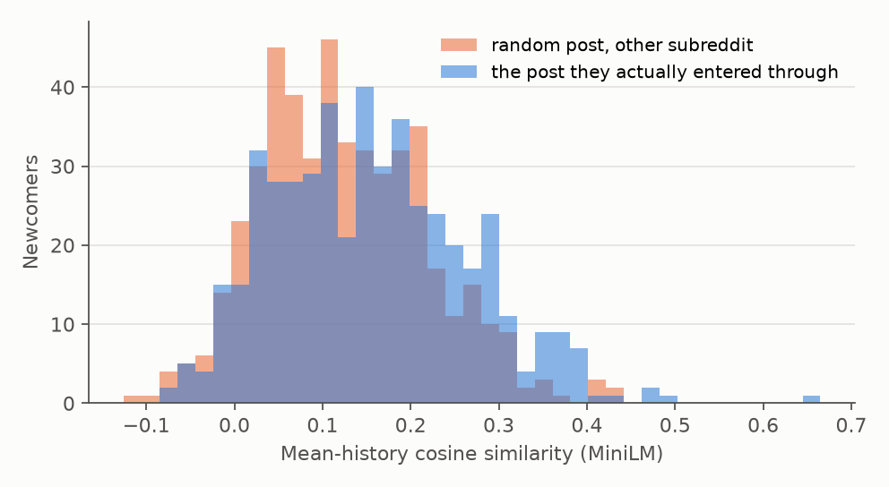
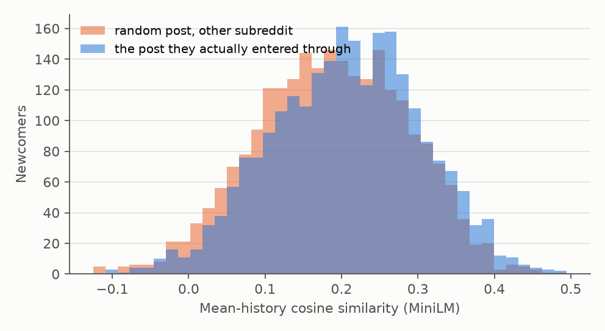
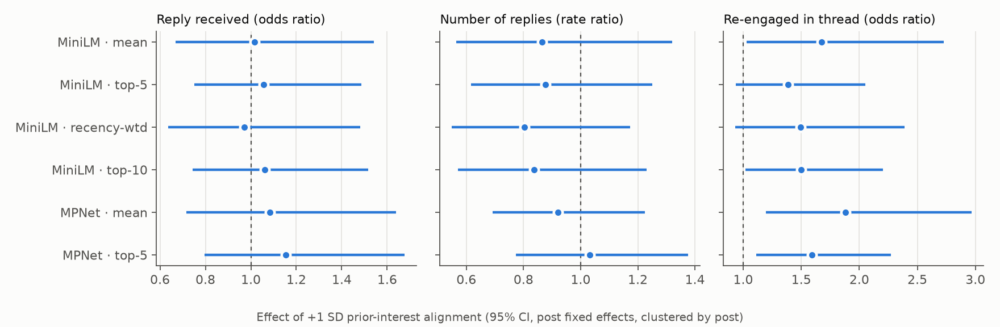
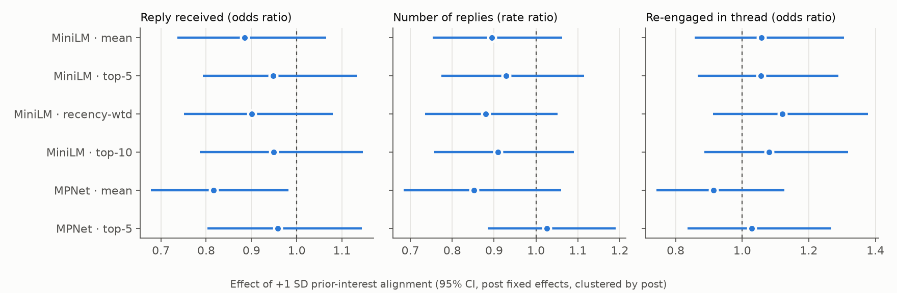
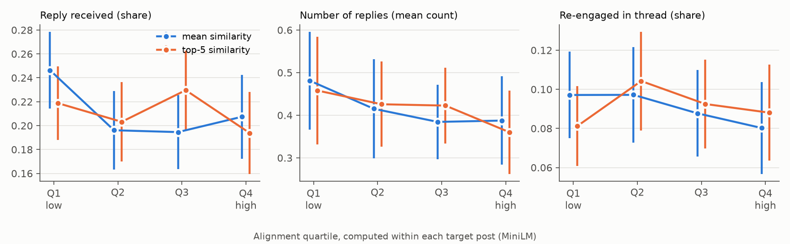

# Prior-Interest Alignment and Newcomer Participation in Reddit Communities
## Experiment Report: Pilot and Site-Wide Replication

*Implements §13 ("Feasible First Experiment") of the project proposal in two target-post samples. All numbers come from the scripts in `src/`. Outputs are in `results/` (Study 1) and `results/global/` (Study 2).*

---

## 1. Summary

We asked whether newcomers whose prior Reddit interests align with the post through which they enter a community participate differently from newcomers whose interests are less aligned. We ran the same pipeline on two sets of high-visibility posts:

| | **Study 1: Topical subreddits (pilot)** | **Study 2: Site-wide top posts of 2025** |
|---|---|---|
| Target posts | 80 posts in the top 5% by comments; r/technology, r/science, r/movies, r/gaming; March 2026 | 247 posts from Reddit's official "Top Posts of 2025" list, across 83 subreddits |
| Sampled commenters | 3,200 (40 per post) | 4,924 (20 per post) |
| Observed newcomers | **479 (15%)** | **2,413 (49%)** |

**Main findings (models with post fixed effects, i.e. comparisons within the same post):**

1. **Site-wide top posts pull in a much larger share of newcomers.**
   - Half of the commenters on the 2025 top posts had no activity in that subreddit in the prior year.
   - On the top posts of large topical subreddits, the share was 15%.
   - This supports treating site-wide popular posts as the main "entry events" for studying newcomers.
2. **Alignment is not associated with whether a newcomer's first comment is answered.** The result holds in both studies.
   - Study 1: reply received odds ratio (OR) 1.02 per SD of alignment; number of replies rate ratio (RR) 0.86.
   - Study 2: reply received OR 0.89 [0.74, 1.07]; number of replies RR 0.90 [0.75, 1.06].
   - Across 18 model variants per study (6 alignment measures × 3 outcomes), only one reply coefficient reaches p < .05 (Study 2, MPNet mean, OR 0.82). That is about what chance alone would produce.
3. **The pilot's re-engagement association did not replicate.**
   - In Study 1, more-aligned newcomers were more likely to comment again in the same thread (OR 1.68, p = .038).
   - In Study 2, with five times as many newcomers, the estimate is essentially zero: OR 1.06, 95% CI [0.86, 1.31], p = .60. It is null for all six alignment measures and all robustness specifications.
   - The pilot result is best treated as a likely false positive, or as an effect confined to discussion-oriented topical communities. It should not be reported as a finding.
4. **Newcomers re-engage less than existing members, in both studies.**
   - Study 1: 16.1% vs 22.2%, adjusted OR 0.72 [0.53, 0.98].
   - Study 2: 9.1% vs 14.7%, adjusted OR 0.65 [0.47, 0.89], p = .007.
   - Newcomers also receive fewer replies in raw terms. That gap is explained by entry timing and comment position rather than newcomer status.

**Bottom line:** in this first operationalization, the embedding-based prior-interest alignment measure does not predict how newcomers' first comments fare or whether they keep talking. Newcomer status itself does predict re-engagement, and it replicates across both samples. Section 6 discusses why the alignment measure may be too weak for this setting (short, meme-style titles and a small separation between aligned and unaligned users), and what to change before concluding the effect is absent.

---

## 2. Data

### 2.1 Sources

- **Reddit data: [Arctic Shift](https://github.com/ArthurHeitmann/arctic_shift)** (`arctic-shift.photon-reddit.com`), the successor to Pushshift. It is a public archive of Reddit submissions and comments, widely used in computational social science. It gives full per-user histories with timestamps, so histories can be cut off strictly before each target post (no look-ahead), and complete comment trees.
- **Study 2 target list:** Reddit's own "Top Posts of 2025" page (`reddit.com/posts/2025/global/`). Reddit serves this page only to browsers, so it was saved manually from a browser. Its 250 post IDs were extracted and looked up in Arctic Shift; 249 were found. Two posts repeatedly timed out on the archive server, which leaves 247.

**Coverage.** The archive holds 65,833 comments on the 80 Study 1 posts and 408,484 on the 247 Study 2 posts. That is 107% (Study 1) and 121% (Study 2) of Reddit's reported comment counts at the median, because the archive also keeps comments removed later. The threads are therefore essentially complete.

### 2.2 Sample construction

| Stage | Rule | Study 1 | Study 2 |
|---|---|---|---|
| Target posts | S1: at or above the 95th percentile of comments within subreddit-month, not removed or NSFW, 20 sampled per subreddit. S2: all posts on the 2025 top list | 80 | 247 (83 subreddits; median 660 comments) |
| Commenters | Random sample per post; `[deleted]`, AutoModerator, bot-pattern names and the post's author excluded | 3,200 (40/post) | 4,924 (20/post; 16 failed lookups) |
| History | Latest ≤ 100 comments and ≤ 100 posts in the 365 days before the post; target subreddit, `[deleted]`/`[removed]` and items under 20 characters excluded | 3,081 with history | 4,556 with history |
| **Observed newcomer** | 0 activity in the target subreddit in the prior 12 months **and** ≥ 20 usable history items | **479** | **2,413** |
| Existing member | ≥ 3 activities in the target subreddit in the prior 12 months, ≥ 20 history items | 2,209 | 1,363 |

**Typical newcomer:**

| | Study 1 | Study 2 |
|---|---|---|
| Usable history items (median) | 96 | 95 |
| Distinct prior subreddits (median) | 30 | 33 |
| Hours from post creation to first comment (median) | 5.3 | 7.0 |
| First comments that are top-level | 44.7% | 60.9% |

**Other differences between the samples:**
- **Study 2 content is mostly images and video.** Only 9% of its posts have body text, so the post side of the alignment measure is essentially the title.
- **Newcomer share by subreddit in Study 2:** median 53%, range 15%–88%.
- **Study 1 newcomers by subreddit:** science 222, movies 95, technology 94, gaming 68.

---

## 3. Measures

### 3.1 Prior-interest alignment (independent variable)

Each history item and the target post (title plus body) were embedded with **all-MiniLM-L6-v2** (primary model) and **all-mpnet-base-v2** (second model, used for the RQ3 robustness check).

| Measure | Definition |
|---|---|
| `mean` | cosine(mean of the user's history embeddings, post embedding) |
| `recency-weighted` | as `mean`, but each item is weighted by 0.5^(age in days / 30) |
| `top-5` / `top-10` | mean cosine of the 5 (or 10) history items most similar to the post |

All alignment measures are z-scored, so effects are reported per 1 SD of alignment.

### 3.2 Outcomes (the newcomer's first comment in the target thread)

- **Reply received:** at least one direct reply from another user (AutoModerator and self-replies excluded).
- **Number of replies:** count of such direct replies.
- **Re-engagement:** the newcomer commented again in the same thread after the first comment.

| Newcomer base rates | Study 1 | Study 2 |
|---|---|---|
| Reply received | 29.0% | 21.4% |
| Mean number of replies | 0.59 | 0.42 |
| Re-engaged | 16.1% | 9.1% |

### 3.3 Controls (proposal §9)

- **History:** log history size, log number of distinct prior subreddits, log mean history comment length, log activity rate, historical engagement (asinh of median comment score).
- **Entry:** log minutes from post creation to the first comment, top-level vs reply, log number of comments already in the thread.
- **Target-post fixed effects** in every model, so newcomers are compared only with other newcomers on the same post.

### 3.4 Estimation

- **Binary outcomes:** fixed-effects logit.
- **Number of replies:** fixed-effects Poisson, with negative binomial as a robustness check.
- **Standard errors:** clustered by post.
- **Dropped posts:** posts with no within-post variation in an outcome are uninformative under post fixed effects and are dropped for that outcome.

---

## 4. Results

### 4.1 Validity of the alignment measure

| Check | Study 1 | Study 2 |
|---|---|---|
| Alignment with the entry post vs a random post from another subreddit (MiniLM mean) | 0.156 vs 0.125; higher for 57% of users; p < 10⁻⁴ | 0.207 vs 0.188; higher for 57% of users; p < 10⁻¹² |
| Same comparison, top-5 measure | 0.224 vs 0.200; p < 10⁻⁷ | 0.227 vs 0.215; p < 10⁻¹⁷ |
| Entry post vs another top post from the *same* subreddit | 0.156 vs 0.131; p < .001 | 0.207 vs 0.193; p < 10⁻⁶ (n = 1,942 where a second post exists) |
| MiniLM vs MPNet agreement (Spearman ρ, mean / top-5) | 0.81 / 0.83 | 0.81 / 0.74 |
| Existing members' outside history vs newcomers' (MiniLM mean) | 0.204 vs 0.156 | 0.226 vs 0.207 |

In both samples the measure tracks something real: users are reliably more similar to the post they chose to comment on than to other posts, and the two embedding models agree. But the separation is small. Only about 57% of newcomers are more aligned with their own entry post than with a random one, so individual scores carry substantial noise. Study 2's gap is smaller in absolute terms (0.019 vs 0.031), which fits its short, meme-style titles.



*Figure 3a (Study 1). Mean-history similarity to the entry post (blue) vs to a random post from another subreddit (orange).*



*Figure 3b (Study 2). Same comparison.*

### 4.2 Main results

Effect of +1 SD alignment, with post fixed effects, all controls, and SEs clustered by post:

**Study 1: topical subreddits** (reply outcomes n = 395 on 51 posts; re-engagement n = 337 on 39 posts)

| Alignment measure | Reply received, OR [95% CI] | Number of replies, RR [95% CI] | Re-engaged, OR [95% CI] |
|---|---|---|---|
| MiniLM · mean | 1.02 [0.67, 1.54] | 0.86 [0.57, 1.32] | **1.68 [1.03, 2.73]**, p = .038 |
| MiniLM · recency-weighted | 0.97 [0.64, 1.48] | 0.80 [0.55, 1.17] | 1.49 [0.93, 2.39] |
| MiniLM · top-5 | 1.06 [0.75, 1.49] | 0.88 [0.62, 1.25] | 1.39 [0.93, 2.05] |
| MiniLM · top-10 | 1.06 [0.74, 1.52] | 0.84 [0.57, 1.23] | **1.50 [1.02, 2.20]** |
| MPNet · mean | 1.08 [0.72, 1.64] | 0.92 [0.69, 1.23] | **1.88 [1.20, 2.97]** |
| MPNet · top-5 | 1.15 [0.80, 1.68] | 1.03 [0.77, 1.38] | **1.59 [1.11, 2.27]** |

**Study 2: site-wide top posts of 2025** (reply outcomes n = 1,984 on 192 posts; re-engagement n = 1,420 on 131 posts)

| Alignment measure | Reply received, OR [95% CI] | Number of replies, RR [95% CI] | Re-engaged, OR [95% CI] |
|---|---|---|---|
| MiniLM · mean | 0.89 [0.74, 1.07] | 0.90 [0.75, 1.06] | 1.06 [0.86, 1.31] |
| MiniLM · recency-weighted | 0.90 [0.75, 1.08] | 0.88 [0.74, 1.05] | 1.12 [0.91, 1.38] |
| MiniLM · top-5 | 0.95 [0.79, 1.13] | 0.93 [0.77, 1.11] | 1.06 [0.87, 1.29] |
| MiniLM · top-10 | 0.95 [0.79, 1.15] | 0.91 [0.76, 1.09] | 1.08 [0.89, 1.32] |
| MPNet · mean | **0.82 [0.68, 0.98]**, p = .031 | 0.85 [0.68, 1.06] | 0.91 [0.74, 1.13] |
| MPNet · top-5 | 0.96 [0.80, 1.14] | 1.03 [0.88, 1.19] | 1.03 [0.84, 1.27] |



*Figure 1a (Study 1). Effect of +1 SD alignment by measure and outcome (95% CI).*



*Figure 1b (Study 2). Same models. The intervals are about half as wide as in Study 1, and all re-engagement estimates sit near 1.*



*Figure 2b (Study 2). Raw outcome rates by alignment quartile formed within each post (posts with ≥ 4 newcomers), with 95% CIs. No quartile pattern appears for any outcome. The Study 1 version is `results/fig2_quartiles.png`.*

**Answers to the research questions (current operationalization):**
- **RQ1:** no reliable association between prior-interest alignment and newcomers' first-participation outcomes.
- **RQ2:** highly and weakly aligned newcomers do not differ in receiving replies or in the number of replies. The pilot's apparent re-engagement difference disappears in the larger sample.
- **RQ3:** the null holds across two embedding models and four aggregation methods (mean, recency-weighted, top-5, top-10). Isolated significant coefficients do not repeat across measures or samples.

### 4.3 The pilot re-engagement result under closer inspection

Receiving a reply gives an obvious reason to comment again, so re-engagement was also examined by reply status (`reengagement_check.csv` in each results folder):

| Specification (MiniLM mean) | Study 1 OR [95% CI] | Study 2 OR [95% CI] |
|---|---|---|
| Control for reply received | 1.78 [1.02, 3.10] | 1.16 [0.91, 1.48] |
| Only newcomers who received a reply | 3.86 [1.33, 11.19] (n = 88) | 0.94 [0.57, 1.55] (n = 310) |
| Only newcomers who received no reply | 1.18 [0.47, 2.97] (n = 132) | 1.15 [0.76, 1.75] (n = 561) |

In the pilot, the association was concentrated among the 88 newcomers who received a reply. In Study 2, with 3.5× as many replied-to newcomers, the estimate is 0.94. The pilot pattern rested on a small subgroup and did not generalize.

### 4.4 Robustness (MiniLM mean; full tables in `robustness.csv`)

| Specification | Study 1: reply / replies / re-engaged | Study 2: reply / replies / re-engaged |
|---|---|---|
| Baseline (12-month lookback) | 1.02 / 0.86 / 1.68* | 0.89 / 0.90 / 1.06 |
| 6-month lookback | 1.11 / 0.79 / 1.84** | 0.88 / 0.90 / 1.07 |
| 3-month lookback | 0.99 / 0.87 / 1.42† | 0.90 / 0.90 / 1.06 |
| ≥ 50 history items | 0.95 / 0.77 / 1.71† | 0.89 / 0.92 / 1.09 |
| + first-comment length | 1.01 / 0.83 / 1.69* | 0.88 / 0.88 / 1.05 |
| Cluster SEs by user | 1.02 / 0.86 / 1.68** | 0.89 / 0.90 / 1.06 |
| Top-level comments only | n/a / 2.38* / n/a (n ≈ 85) | 0.79 / 0.97 / 1.07 (n = 626 / 433) |
| Negative binomial (replies) | – / 0.92 / – | – / 0.94 / – |

† p < .10, * p < .05, ** p < .01. "n/a" means too few posts with outcome variation to estimate. Every Study 2 estimate has p > .14.

### 4.5 Secondary: newcomers vs existing members (same posts, same controls)

| Outcome | Study 1: newcomer / existing, adjusted ratio | Study 2: newcomer / existing, adjusted ratio |
|---|---|---|
| Reply received | 29.0% / 35.9%, OR 0.95 [0.74, 1.21] | 21.4% / 28.5%, OR 0.86 [0.67, 1.09] |
| Number of replies | 0.59 / 0.89, RR 1.00 [0.80, 1.25] | 0.42 / 0.76, RR 0.95 [0.72, 1.26] |
| Re-engaged | 16.1% / 22.2%, **OR 0.72 [0.53, 0.98]** | 9.1% / 14.7%, **OR 0.65 [0.47, 0.89]**, p = .007 |

This is the one result that replicates across both samples. Once timing and thread position are accounted for, newcomers are answered about as often as existing members, but they are about a third less likely to continue the conversation.

---

## 5. Interpretation

Two readings of the null alignment result are possible, and this experiment cannot fully separate them:

1. **The relationship is genuinely weak.** Whether a first comment gets a reply seems to depend mainly on timing, position and the comment itself, not on the commenter's background. Re-engagement appears to depend more on being a newcomer than on topical fit.
2. **The measure is too coarse to detect it.** Several features of the current setup weaken the alignment signal:
   - *Short targets.* 91% of the Study 2 posts have no body text; they are mostly images and videos represented only by a short title, such as "My cat did this". An embedding of that says little about the topic.
   - *Heterogeneous histories.* The median newcomer's history spans 30+ subreddits. The mean representation blurs this, and top-k similarity picks up incidental matches.
   - *Small separation.* Only about 57% of users are more aligned with their own entry post than with a random post. Noise of that size biases effects toward zero.

Study 2's confidence intervals are fairly tight: a +1 SD increase in alignment is unlikely to change re-engagement odds by more than about ±30%. Any real effect of alignment, *as measured here*, is therefore modest at most.

---

## 6. Limitations

1. **Measurement validity** (see §5). This is the main open issue. The proposal's human validation (§6) and Jev-based measure have not yet been run.
2. **"Observed" newcomers only.** Absence from the archive in the lookback window does not prove a user never participated, and lurking is invisible.
3. **Truncated histories.** Only each user's latest ≤ 100 comments and ≤ 100 posts are used, which covers only recent weeks for heavy users.
4. **Study 2 target list.** The 2025 top-posts page is curated by Reddit using an undocumented ranking. It was saved manually on 28 Sep 2026, and 3 of its 250 posts are missing from the analysis.
5. **Observational design.** Post fixed effects remove post-level confounding, but not unobserved user traits. All results are associations.
6. **Multiple testing.** Each study fits 18 main models. Isolated p ≈ .03–.04 results should be expected by chance, and the Study 1 re-engagement result illustrates this.
7. **Archive quality.** Comments deleted before the archive captured them are missing, and comment scores are early snapshots. Scores are used only as a control.

---

## 7. Recommended next steps

1. **Improve the post-side representation before scaling further.**
   - For image and video posts, add the text of the first ~20 top-level comments or the post's image caption as context.
   - Alternatively, restrict to text posts or discussion-oriented subreddits, where the pilot suggested a signal might exist.
2. **Human validation (proposal §6).**
   - Annotate 150–300 user–post pairs on the 0–4 scale.
   - If humans agree with each other but not with the embeddings, the measurement problem is confirmed.
3. **Jev or other LLM-based alignment (proposal Method 2).** Compare with the embedding measures on the same pairs, especially for short titles.
4. **Build on the replicated newcomer effect.**
   - Newcomers' lower re-engagement is robust across both samples.
   - Model *why*: what newcomers' first comments look like (questions, jokes, disagreement), and whether reply tone predicts continuation (the proposal's secondary outcomes).
5. **Pre-register** any re-test of the alignment → re-engagement hypothesis in discussion-oriented communities, given that the pilot result failed to replicate in Study 2.

---

## 8. Reproducibility

```
src/api.py                    cached Arctic Shift client; STUDY env var selects data/<study>, results/<study>
src/s1_select_posts.py        Study 1: enumerate March-2026 posts, select top-5% posts
src/s1_global_2025.py         Study 2: parse saved "Top Posts of 2025" page, look up posts
src/s2_collect_threads.py     full comment trees for target posts
src/s3_collect_users.py       in-subreddit activity check + 365-day histories (USERS_PER_POST env var)
src/s4_features.py            outcomes, controls, embedding alignment (GPU if available; chunked cache)
src/s5_analysis.py            validity checks, FE regressions, robustness, newcomer vs existing
src/s5b_reengagement_check.py reply-conditioned re-engagement models
src/s6_figures.py             figures
```

- **Study 1:** run `s1_select_posts.py`, then `s2`–`s6`.
- **Study 2:** set `STUDY=global USERS_PER_POST=20`, then run `s1_global_2025.py` and `s2`–`s6`.
- **Seeds:** posts 42, users 7, validity draws 0.
- **Re-runs:** all API responses are cached in `data/cache/`, so re-runs make no new requests.
- **Environment:** embeddings were computed on an NVIDIA RTX 5060 with PyTorch 2.11 (CUDA 12.8). A full CPU re-run of Study 1 gave identical estimates to four decimal places.
