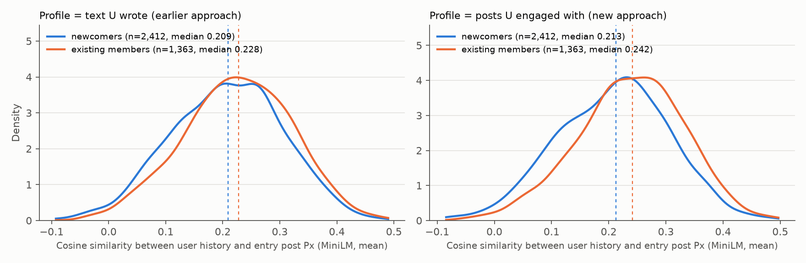
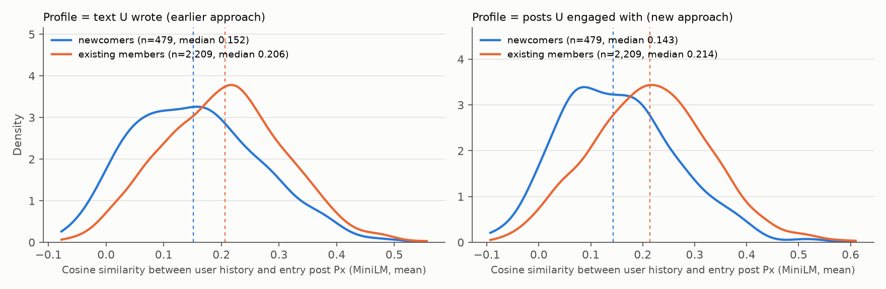
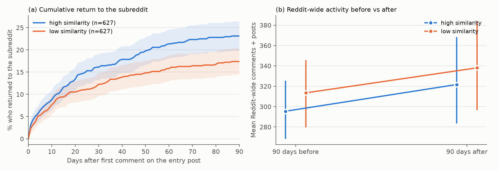
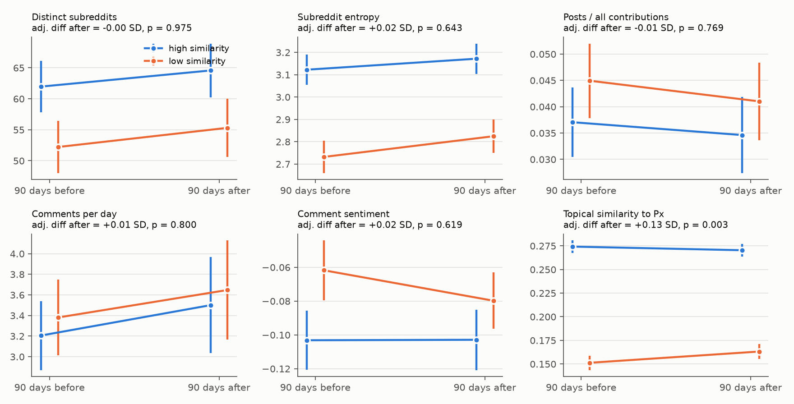
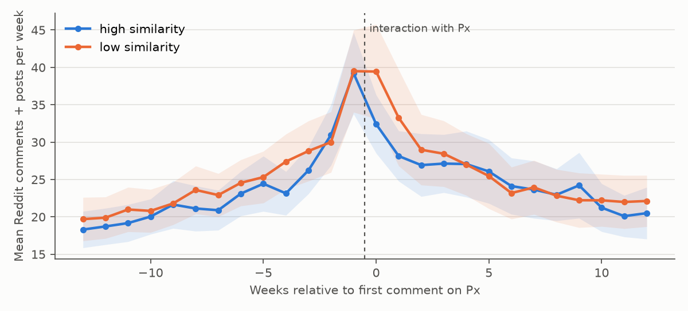

# Prior-Interest Alignment and Newcomer Participation in Reddit Communities
## Experiment Report: Pilot and Site-Wide Replication

*Implements §13 ("Feasible First Experiment") of the project proposal in two target-post samples, extended with Step 6 (comment content, community integration and return; §4.6) a post-based user profile (users represented by the posts they engaged with; §4.7), a high- vs low-similarity comparison of newcomers' activity after the interaction (§4.8), and a before-vs-after comparison of their language, interactivity, diversity and activity (§4.9). All numbers come from the scripts in `src/`. Outputs are in `results/` (Study 1) and `results/global/` (Study 2).*

---

## 1. Summary

We asked whether newcomers whose prior Reddit interests align with the post through which they enter a community participate differently from newcomers whose interests are less aligned. We ran the same pipeline on two sets of high-visibility posts:

| | **Study 1: Topical subreddits (pilot)** | **Study 2: Site-wide top posts of 2025** |
|---|---|---|
| Target posts | 80 posts in the top 5% by comments; r/technology, r/science, r/movies, r/gaming; March 2026 | 247 posts from Reddit's official "Top Posts of 2025" list, across 83 subreddits |
| Sampled commenters | 3,200 (40 per post) | 4,924 (20 per post) |
| Observed newcomers | **479 (15%)** | **2,413 (49%)** |

**Main findings (models with post fixed effects, i.e. comparisons within the same post):**

1. **Site-wide top posts pull in a much larger share of newcomers.**
   - Half of the commenters on the 2025 top posts had no activity in that subreddit in the prior year.
   - On the top posts of large topical subreddits, the share was 15%.
   - This supports treating site-wide popular posts as the main "entry events" for studying newcomers.
2. **Alignment is not associated with whether a newcomer's first comment is answered.** The result holds in both studies.
   - Study 1: reply received odds ratio (OR) 1.02 per SD of alignment; number of replies rate ratio (RR) 0.86.
   - Study 2: reply received OR 0.89 [0.74, 1.07]; number of replies RR 0.90 [0.75, 1.06].
   - Across 18 model variants per study (6 alignment measures × 3 outcomes), only one reply coefficient reaches p < .05 (Study 2, MPNet mean, OR 0.82). That is about what chance alone would produce.
3. **The pilot's re-engagement association did not replicate.**
   - In Study 1, more-aligned newcomers were more likely to comment again in the same thread (OR 1.68, p = .038).
   - In Study 2, with five times as many newcomers, the estimate is essentially zero: OR 1.06, 95% CI [0.86, 1.31], p = .60. It is null for all six alignment measures and all robustness specifications.
   - The pilot result is best treated as a likely false positive, or as an effect confined to discussion-oriented topical communities. It should not be reported as a finding.
4. **Newcomers re-engage less than existing members, in both studies.**
   - Study 1: 16.1% vs 22.2%, adjusted OR 0.72 [0.53, 0.98].
   - Study 2: 9.1% vs 14.7%, adjusted OR 0.65 [0.47, 0.89], p = .007.
   - Newcomers also receive fewer replies in raw terms. That gap is explained by entry timing and comment position rather than newcomer status.
5. **Step 6: alignment does not predict *what* newcomers write** (§4.6).
   - Study 2 shows no association with asking questions, disagreeing, sentiment, toxicity, pronoun use or other style measures, or with how closely the first comment matches the ongoing discussion.
   - The tone of replies newcomers receive and back-and-forth continuation are also unrelated to alignment.
   - One consistent exploratory pattern: more-aligned newcomers write comments whose topic is closer to the post (Study 2: +0.07 SD; Study 1: +0.19 SD, FDR-adjusted p = .02).
6. **Step 6: more-aligned newcomers are more likely to come back to the community.**
   - In Study 2, each +1 SD of alignment raises the odds of posting or commenting in the subreddit again within 90 days by about a quarter: OR 1.26 [1.05, 1.51], FDR-adjusted p = .043. The MPNet measure gives the same result (OR 1.27).
   - This is the only pre-specified primary outcome that survives correction.
   - It is not seen in the smaller pilot (OR 0.94 [0.67, 1.34], n = 369), whose interval is too wide to confirm or rule it out.
7. **Representing users by the posts they engaged with gives the same conclusions and separates newcomers from members more clearly** (§4.7).
   - Under the post-to-post definition (U's profile = the posts U commented on before Px), existing members' histories are closer to the entry post than newcomers'. The within-post gap is −0.35 SD, vs −0.25 SD with the text-based profile, in Study 2.
   - Among newcomers the two profiles are highly correlated (ρ ≈ 0.84) and equally noisy.
   - The 90-day return association holds for every post-based variant (OR 1.23–1.27, p = .01–.02).
8. **High- vs low-similarity newcomers: they differ in where they post afterwards, not in how much** (§4.8).
   - Within each post, the top 25% most similar newcomers are compared with the bottom 25%.
   - Study 2: the high group was more likely to return to the subreddit within 90 days (23.1% vs 17.4%). The result holds across comparisons: post-FE OR 1.67 [1.05, 2.65], and +6.8 pp (p = .010) after propensity matching. The high group also contributed more there afterwards (RR 1.65).
   - Their overall Reddit activity after the interaction, and its change from before, is the same as the low group's.
   - Study 1 (112 per group) shows no difference, but it is too small to be conclusive.
9. **The interaction does not change how high- vs low-similarity newcomers behave in general** (§4.9).
   - 21 metrics were compared over the 90 days before vs after: language (style, sentiment, insult, topic), interactivity (comment/post ratio), interaction diversity (number and entropy of subreddits) and activity (posting frequency, active days).
   - The two groups differ in some respects *before* the interaction; for example, high-similarity newcomers already engage in more subreddits (62 vs 52).
   - Their changes after the interaction are parallel, and no metric differs after FDR correction in either study.

   **At a glance (Study 2, high vs low similarity, 90 days before → 90 days after; details in §4.9):**

   | Dimension | Metric | High: before → after | Low: before → after | Adjusted difference after |
   |---|---|---|---|---|
   | Language | Comment length, questions, I / you / we, hedging, exclamations, laughter | No clear change | No clear change | None significant (FDR p ≥ .59) |
   | | Sentiment | −0.10 → −0.10 | −0.06 → −0.08 | Not significant (p = .62) |
   | | Insult | 0.073 → 0.074 | 0.055 → 0.057 | Not significant (p = .40) |
   | Interactivity | Posts as a share of all contributions | 3.7% → 3.5% | 4.5% → 4.1% | Not significant (p = .77) |
   | Diversity | Distinct subreddits engaged | 62 → 65 | 52 → 55 | Not significant (p = .98) |
   | | Subreddit entropy | 3.12 → 3.17 | 2.73 → 2.82 | Not significant (p = .64) |
   | | New subreddits after the interaction | – | – | Not significant (p = .71) |
   | Activity | Comments per day / posts per day / active days | Small changes, parallel to low group | Small changes, parallel to high group | None significant |

10. **Exploratory: a newcomer's position in the community network predicts retention better than topical alignment does** (§4.10–4.11).
    - Subreddit embeddings were built from co-membership (community2vec-style). Fit is how close the newcomer's prior subreddits are to the target community.
    - This fit discriminates the entry community better than text alignment: 62% of newcomers score higher for their entry subreddit than for a random one, vs 57% for text.
    - In Study 2 it predicts 90-day return (OR 1.52 per SD, FDR p < .001) and becoming a regular (OR 1.68), also after controlling for text alignment (ρ = 0.23 between the two). It is null for a placebo subreddit.
    - The association is stronger at 180 days: return OR 1.64, active in months 4–6 OR 1.69. Between the bottom and top within-post quartiles, 180-day return goes from 19% to 33%.
    - It is unchanged when the embeddings are trained on three times as many users.
    - In Study 1 the direction is the same (180-day return OR 1.49, FDR p = .042). But Study 1's four subreddits are too close in the network to separate fit to the specific community from a placebo (§4.11).
    - Reception of the first comment (reply, OP reply, score, reply tone), generalist/specialist breadth and style-norm fit do not predict return.
    - Neither does whether the reply came from a community insider. On viral posts, 57% of replies to newcomers come from other outsiders.

11. **High- and low-fit newcomers differ in whether they stay, not in how they participate** (§4.12).
    - Across 20 first-comment outcomes, 21 Reddit-wide behavior metrics and 13 in-community behaviors of returners, no difference survives FDR in either study. Apparent shifts in topic and neighbourhood after entry are regression-to-the-mean artifacts.
    - The differences lie before entry.
      - High-fit newcomers were twice as likely to have talked with the community's members (33% vs 17%). These ties do not predict return, and fit predicts return unchanged when they are controlled.
      - Only fit in the last 30 days before entry predicts return (180-day OR 2.06 per SD). Fit from earlier in the year does not (OR 0.91–1.24). Newcomers who stay were already moving toward the community.

12. **A decision model (Jev) as a second instrument confirms both patterns** (§4.13; $1.85 of API cost).
    - Jev reads the post image and the newcomer's subreddits and history. It separates newcomers from members 1.6× better than the embeddings (−0.55 vs −0.35 SD) and discriminates the entry post slightly better (59% vs 57%).
    - Even so, alignment does not predict first-contact behavior. Richer codings of first comments (insider knowledge, identity signals) and of replies (gatekeeping, welcoming) are also null. Gatekeeping is rare (2.5% of replies to newcomers vs 1.7% to members).
    - Jev's community alignment predicts 180-day return (OR 1.44) and becoming a regular (1.49) net of its own placebo score, and still 1.27 / 1.37 net of c2v fit. Using only the names of the newcomer's top 20 subreddits, it matches c2v.
    - With Jev scoring each pre-entry window separately, only the last 30 days predicts return (OR 1.57), replicating §4.12 F4 with an independent measure.

**Bottom line:** prior-interest alignment, as measured here, does not shape how a newcomer's *first* comment looks or how it is received. There is initial evidence that it predicts whether the newcomer *returns*: better-aligned newcomers are more likely to become repeat participants. This return result needs confirmation in a pre-registered replication. Separately, newcomer status itself robustly predicts lower in-thread re-engagement. Section 5 discusses why the alignment measure may be too weak to detect first-comment differences (short, meme-style titles and a small separation between aligned and unaligned users).

---

## 2. Data

### 2.1 Sources

- **Reddit data: [Arctic Shift](https://github.com/ArthurHeitmann/arctic_shift)** (`arctic-shift.photon-reddit.com`), the successor to Pushshift. It is a public archive of Reddit submissions and comments, widely used in computational social science. It gives full per-user histories with timestamps, so histories can be cut off strictly before each target post (no look-ahead), and complete comment trees.
- **Study 2 target list:** Reddit's own "Top Posts of 2025" page (`reddit.com/posts/2025/global/`). Reddit serves this page only to browsers, so it was saved manually from a browser. Its 250 post IDs were extracted and looked up in Arctic Shift; 249 were found. Two posts repeatedly timed out on the archive server, which leaves 247.

**Coverage.** The archive holds 65,833 comments on the 80 Study 1 posts and 408,484 on the 247 Study 2 posts. That is 107% (Study 1) and 121% (Study 2) of Reddit's reported comment counts at the median, because the archive also keeps comments removed later. The threads are therefore essentially complete.

### 2.2 Sample construction

| Stage | Rule | Study 1 | Study 2 |
|---|---|---|---|
| Target posts | S1: at or above the 95th percentile of comments within subreddit-month, not removed or NSFW, 20 sampled per subreddit. S2: all posts on the 2025 top list | 80 | 247 (83 subreddits; median 660 comments) |
| Commenters | Random sample per post; `[deleted]`, AutoModerator, bot-pattern names and the post's author excluded | 3,200 (40/post) | 4,924 (20/post; 16 failed lookups) |
| History | Latest ≤ 100 comments and ≤ 100 posts in the 365 days before the post; target subreddit, `[deleted]`/`[removed]` and items under 20 characters excluded | 3,081 with history | 4,556 with history |
| **Observed newcomer** | 0 activity in the target subreddit in the prior 12 months **and** ≥ 20 usable history items | **479** | **2,413** |
| Existing member | ≥ 3 activities in the target subreddit in the prior 12 months, ≥ 20 history items | 2,209 | 1,363 |

**Typical newcomer:**

| | Study 1 | Study 2 |
|---|---|---|
| Usable history items (median) | 96 | 95 |
| Distinct prior subreddits (median) | 30 | 33 |
| Hours from post creation to first comment (median) | 5.3 | 7.0 |
| First comments that are top-level | 44.7% | 60.9% |

**Other differences between the samples:**
- **Study 2 content is mostly images and video.** Only 9% of its posts have body text, so the post side of the alignment measure is essentially the title.
- **Newcomer share by subreddit in Study 2:** median 53%, range 15%–88%.
- **Study 1 newcomers by subreddit:** science 222, movies 95, technology 94, gaming 68.

---

## 3. Measures

### 3.1 Prior-interest alignment (independent variable)

Each history item and the target post (title plus body) were embedded with **all-MiniLM-L6-v2** (primary model) and **all-mpnet-base-v2** (second model, used for the RQ3 robustness check).

| Measure | Definition |
|---|---|
| `mean` | cosine(mean of the user's history embeddings, post embedding) |
| `recency-weighted` | as `mean`, but each item is weighted by 0.5^(age in days / 30) |
| `top-5` / `top-10` | mean cosine of the 5 (or 10) history items most similar to the post |

All alignment measures are z-scored, so effects are reported per 1 SD of alignment.

### 3.2 Outcomes (the newcomer's first comment in the target thread)

- **Reply received:** at least one direct reply from another user (AutoModerator and self-replies excluded).
- **Number of replies:** count of such direct replies.
- **Re-engagement:** the newcomer commented again in the same thread after the first comment.

| Newcomer base rates | Study 1 | Study 2 |
|---|---|---|
| Reply received | 29.0% | 21.4% |
| Mean number of replies | 0.59 | 0.42 |
| Re-engaged | 16.1% | 9.1% |

### 3.3 Controls (proposal §9)

- **History:** log history size, log number of distinct prior subreddits, log mean history comment length, log activity rate, historical engagement (asinh of median comment score).
- **Entry:** log minutes from post creation to the first comment, top-level vs reply, log number of comments already in the thread.
- **Target-post fixed effects** in every model, so newcomers are compared only with other newcomers on the same post.

### 3.4 Estimation

- **Binary outcomes:** fixed-effects logit.
- **Number of replies:** fixed-effects Poisson, with negative binomial as a robustness check.
- **Standard errors:** clustered by post.
- **Dropped posts:** posts with no within-post variation in an outcome are uninformative under post fixed effects and are dropped for that outcome.

---

## 4. Results

### 4.1 Validity of the alignment measure

| Check | Study 1 | Study 2 |
|---|---|---|
| Alignment with the entry post vs a random post from another subreddit (MiniLM mean) | 0.156 vs 0.125; higher for 57% of users; p < 10⁻⁴ | 0.207 vs 0.188; higher for 57% of users; p < 10⁻¹² |
| Same comparison, top-5 measure | 0.224 vs 0.200; p < 10⁻⁷ | 0.227 vs 0.215; p < 10⁻¹⁷ |
| Entry post vs another top post from the *same* subreddit | 0.156 vs 0.131; p < .001 | 0.207 vs 0.193; p < 10⁻⁶ (n = 1,942 where a second post exists) |
| MiniLM vs MPNet agreement (Spearman ρ, mean / top-5) | 0.81 / 0.83 | 0.81 / 0.74 |
| Existing members' outside history vs newcomers' (MiniLM mean) | 0.204 vs 0.156 | 0.226 vs 0.207 |

In both samples the measure tracks something real: users are reliably more similar to the post they chose to comment on than to other posts, and the two embedding models agree. But the separation is small. Only about 57% of newcomers are more aligned with their own entry post than with a random one, so individual scores carry substantial noise. Study 2's gap is smaller in absolute terms (0.019 vs 0.031), which fits its short, meme-style titles.


*Figure 3a (Study 1). Mean-history similarity to the entry post (blue) vs to a random post from another subreddit (orange).*


*Figure 3b (Study 2). Same comparison.*

### 4.2 Main results

Effect of +1 SD alignment, with post fixed effects, all controls, and SEs clustered by post:

**Study 1: topical subreddits** (reply outcomes n = 395 on 51 posts; re-engagement n = 337 on 39 posts)

| Alignment measure | Reply received, OR [95% CI] | Number of replies, RR [95% CI] | Re-engaged, OR [95% CI] |
|---|---|---|---|
| MiniLM · mean | 1.02 [0.67, 1.54] | 0.86 [0.57, 1.32] | **1.68 [1.03, 2.73]**, p = .038 |
| MiniLM · recency-weighted | 0.97 [0.64, 1.48] | 0.80 [0.55, 1.17] | 1.49 [0.93, 2.39] |
| MiniLM · top-5 | 1.06 [0.75, 1.49] | 0.88 [0.62, 1.25] | 1.39 [0.93, 2.05] |
| MiniLM · top-10 | 1.06 [0.74, 1.52] | 0.84 [0.57, 1.23] | **1.50 [1.02, 2.20]** |
| MPNet · mean | 1.08 [0.72, 1.64] | 0.92 [0.69, 1.23] | **1.88 [1.20, 2.97]** |
| MPNet · top-5 | 1.15 [0.80, 1.68] | 1.03 [0.77, 1.38] | **1.59 [1.11, 2.27]** |

**Study 2: site-wide top posts of 2025** (reply outcomes n = 1,984 on 192 posts; re-engagement n = 1,420 on 131 posts)

| Alignment measure | Reply received, OR [95% CI] | Number of replies, RR [95% CI] | Re-engaged, OR [95% CI] |
|---|---|---|---|
| MiniLM · mean | 0.89 [0.74, 1.07] | 0.90 [0.75, 1.06] | 1.06 [0.86, 1.31] |
| MiniLM · recency-weighted | 0.90 [0.75, 1.08] | 0.88 [0.74, 1.05] | 1.12 [0.91, 1.38] |
| MiniLM · top-5 | 0.95 [0.79, 1.13] | 0.93 [0.77, 1.11] | 1.06 [0.87, 1.29] |
| MiniLM · top-10 | 0.95 [0.79, 1.15] | 0.91 [0.76, 1.09] | 1.08 [0.89, 1.32] |
| MPNet · mean | **0.82 [0.68, 0.98]**, p = .031 | 0.85 [0.68, 1.06] | 0.91 [0.74, 1.13] |
| MPNet · top-5 | 0.96 [0.80, 1.14] | 1.03 [0.88, 1.19] | 1.03 [0.84, 1.27] |


*Figure 1a (Study 1). Effect of +1 SD alignment by measure and outcome (95% CI).*


*Figure 1b (Study 2). Same models. The intervals are about half as wide as in Study 1, and all re-engagement estimates sit near 1.*


*Figure 2b (Study 2). Raw outcome rates by alignment quartile formed within each post (posts with ≥ 4 newcomers), with 95% CIs. No quartile pattern appears for any outcome. The Study 1 version is `results/fig2_quartiles.png`.*

**Answers to the research questions (current operationalization):**
- **RQ1:** no reliable association between prior-interest alignment and newcomers' first-participation outcomes.
- **RQ2:** highly and weakly aligned newcomers do not differ in receiving replies or in the number of replies. The pilot's apparent re-engagement difference disappears in the larger sample.
- **RQ3:** the null holds across two embedding models and four aggregation methods (mean, recency-weighted, top-5, top-10). Isolated significant coefficients do not repeat across measures or samples.

### 4.3 The pilot re-engagement result under closer inspection

Receiving a reply gives an obvious reason to comment again, so re-engagement was also examined by reply status (`reengagement_check.csv` in each results folder):

| Specification (MiniLM mean) | Study 1 OR [95% CI] | Study 2 OR [95% CI] |
|---|---|---|
| Control for reply received | 1.78 [1.02, 3.10] | 1.16 [0.91, 1.48] |
| Only newcomers who received a reply | 3.86 [1.33, 11.19] (n = 88) | 0.94 [0.57, 1.55] (n = 310) |
| Only newcomers who received no reply | 1.18 [0.47, 2.97] (n = 132) | 1.15 [0.76, 1.75] (n = 561) |

In the pilot, the association was concentrated among the 88 newcomers who received a reply. In Study 2, with 3.5× as many replied-to newcomers, the estimate is 0.94. The pilot pattern rested on a small subgroup and did not generalize.

### 4.4 Robustness (MiniLM mean; full tables in `robustness.csv`)

| Specification | Study 1: reply / replies / re-engaged | Study 2: reply / replies / re-engaged |
|---|---|---|
| Baseline (12-month lookback) | 1.02 / 0.86 / 1.68* | 0.89 / 0.90 / 1.06 |
| 6-month lookback | 1.11 / 0.79 / 1.84** | 0.88 / 0.90 / 1.07 |
| 3-month lookback | 0.99 / 0.87 / 1.42† | 0.90 / 0.90 / 1.06 |
| ≥ 50 history items | 0.95 / 0.77 / 1.71† | 0.89 / 0.92 / 1.09 |
| + first-comment length | 1.01 / 0.83 / 1.69* | 0.88 / 0.88 / 1.05 |
| Cluster SEs by user | 1.02 / 0.86 / 1.68** | 0.89 / 0.90 / 1.06 |
| Top-level comments only | n/a / 2.38* / n/a (n ≈ 85) | 0.79 / 0.97 / 1.07 (n = 626 / 433) |
| Negative binomial (replies) | – / 0.92 / – | – / 0.94 / – |

† p < .10, * p < .05, ** p < .01. "n/a" means too few posts with outcome variation to estimate. Every Study 2 estimate has p > .14.

### 4.5 Secondary: newcomers vs existing members (same posts, same controls)

| Outcome | Study 1: newcomer / existing, adjusted ratio | Study 2: newcomer / existing, adjusted ratio |
|---|---|---|
| Reply received | 29.0% / 35.9%, OR 0.95 [0.74, 1.21] | 21.4% / 28.5%, OR 0.86 [0.67, 1.09] |
| Number of replies | 0.59 / 0.89, RR 1.00 [0.80, 1.25] | 0.42 / 0.76, RR 0.95 [0.72, 1.26] |
| Re-engaged | 16.1% / 22.2%, **OR 0.72 [0.53, 0.98]** | 9.1% / 14.7%, **OR 0.65 [0.47, 0.89]**, p = .007 |

This is the one result that replicates across both samples. Once timing and thread position are accounted for, newcomers are answered about as often as existing members, but they are about a third less likely to continue the conversation.

### 4.6 Step 6: comment content and community integration

This section extends the outcomes from "did the comment get a response?" to *what newcomers write* and *how they integrate*. The design is unchanged: alignment stays continuous (per +1 SD), with post fixed effects, the §3.3 controls and SEs clustered by post. Models for text outcomes also control for comment length (log words). Comment-similarity outcomes also control for the comment's similarity to the user's own history, which removes the built-in correlation that arises because a user's comment resembles their own past writing.

**Measures** (scripts `s7a_collect_return.py`, `s7b_comment_features.py`):

| Group | Measure | Operationalization |
|---|---|---|
| B. Content | Question | Contains "?" or a sentence starting with a question word |
| | Stance (replies only) | Agree / disagree / neutral toward the parent comment; local LLM (Qwen2.5-3B-Instruct) with defined categories and 3 examples in the prompt |
| | Sentiment | `cardiffnlp/twitter-roberta-base-sentiment-latest`, P(pos) − P(neg) |
| | Toxicity | `unitary/unbiased-toxic-roberta`, toxicity and insult probabilities |
| | Linguistic style | Log word count; rates of "I", "you", "we"; hedges; exclamations; laughter/emoji |
| C. Integration | Comment ↔ prior discussion | Cosine similarity (MiniLM) of the first comment to the centroid of all thread comments posted *before* it. Also similarity to the post and to the parent comment |
| | Reply tone | Mean sentiment, maximum insult and any-disagree stance of the direct replies received |
| | Interaction continuation | Answered someone who replied; number of own comments in the exchange |
| | **Return to community** | Any post or comment in the subreddit (outside the target thread) within 30 / 90 days of the first comment |

**Pre-specified primary outcomes:** question, disagreement stance, comment ↔ thread similarity, and 90-day return. p-values are adjusted with Benjamini–Hochberg FDR within the primary family (4 tests) and within the exploratory family (18 tests).

**Primary results** (MiniLM mean; OR for binary outcomes, SD change for continuous ones):

| Outcome | Study 1 (pilot) | Study 2 (global) | Study 2 robustness: MiniLM top-5 / MPNet mean |
|---|---|---|---|
| Asks a question (base rate S1 18%, S2 19%) | OR 0.69 [0.42, 1.14], FDR p = .29 | OR 0.91 [0.76, 1.09], FDR p = .61 | 0.94 / 0.92 |
| Disagrees with parent (replies; S1 34%, S2 30%) | OR 1.03 [0.64, 1.67], FDR p = .91 | OR 0.92 [0.67, 1.27], FDR p = .83 | 1.06 / 0.91 |
| Similarity to prior discussion | +0.12 SD [−0.02, 0.26], FDR p = .29 | −0.01 SD [−0.06, 0.05], FDR p = .83 | +0.04 / −0.02 |
| **Returns within 90 days** (S1 23.6%, S2 20.3%) | OR 0.94 [0.67, 1.34], FDR p = .91 | **OR 1.26 [1.05, 1.51], FDR p = .043** | 1.12 (p = .14) / **1.27 (p = .010)** |

**Exploratory results.** Out of 18 exploratory outcomes, only these were notable (full tables in `content_models.csv`):

| Outcome | Study 1 | Study 2 |
|---|---|---|
| Comment ↔ post similarity | **+0.19 SD, p = .001 (FDR .02)** | +0.07 SD, p = .006 (FDR .10) |
| Comment ↔ parent similarity (replies) | +0.29 SD, p = .008 (FDR .07) | +0.09 SD, p = .065 (FDR .55) |
| Answered a replier (among replied-to) | OR 4.67, p = .016 (FDR .10; n = 78) | OR 1.07, p = .77 (n = 276) |
| Return within 30 days | OR 0.92, p = .73 | OR 1.15, p = .18 |

Sentiment, insult, toxicity, length, pronoun rates, hedging, exclamation and laughter, the tone of replies received, and the number of exchange turns were all null in Study 2 (every p > .13; FDR-adjusted p > .49).

**Newcomers vs existing members on the same posts** (`content_newcomer_vs_existing.csv`): after controls and FDR correction, **no content or integration measure differs significantly** in either study. The closest were fewer exclamations among Study 2 newcomers (OR 0.76, raw p = .04) and lower insult and toxicity among Study 1 newcomers (−0.13 SD, raw p ≈ .03). Neither survives FDR (adjusted p ≥ .36). Newcomers write much like regulars. What differs is whether they keep participating (§4.5).

**Reading of Step 6:**
- **First comments:** high- and low-alignment newcomers write alike and are treated alike. Better-aligned newcomers stay slightly closer to the post's topic, which is expected, but they do not ask fewer questions, disagree more, or write in a different tone.
- **Return:** the one signal in the larger sample is return. Better-aligned newcomers are more likely to come back, consistent with the idea that topical fit matters for *retention* rather than for first-contact behavior. The effect is driven by the *mean* (overall-interest) representations rather than top-k. That fits a general-interest account better than one about a few prior topical matches.
- **Caveats:** this is one significant primary result out of four, in one study, with a non-confirming (but underpowered) pilot. It also cannot distinguish users' own interest from Reddit's feed recommending that subreddit to users with matching interests.

**Stance classifier quality.** An informal spot check of 20 Study 2 stance labels found about 13 plausible. The main error is labeling jokes and elaborations as "disagree". Stance results should be read as provisional until the hand-labeled validation is done. `results/global/validation_sample_to_label.csv` contains 200 newcomer replies with their parent comments and blank columns for question, stance and insult. `validation_auto_labels.csv` holds the automatic labels for comparison.

### 4.7 Post-based user profile: representing users by the posts they engaged with

**Definition.** Sections 4.1–4.6 represent a user's history by *the text the user wrote* (their comments and submissions). Here we use an alternative, post-to-post definition. If user U commented on posts Pa, Pb, Pc and Pd before entering through post Px, U's profile is <Pa, Pb, Pc, Pd>, represented by those posts' own title and body. U's own submissions are included as engaged posts. User–post similarity is then the similarity between <Pa, Pb, Pc, Pd> and Px, computed with the same aggregations (mean, recency-weighted, top-5) and embedding models (MiniLM, MPNet). The same exclusions apply: the 365 days before Px, and the target subreddit removed.

**Construction** (`s9_post_history.py`): each history comment was mapped to the post it was made under, using Arctic Shift ID lookups. The posts were then retrieved and embedded.

| | Study 1 | Study 2 |
|---|---|---|
| Users (newcomers + existing + other) | 3,081 | 4,556 |
| History comments resolved to their post | 296,107 (100%) | 432,078 (100%) |
| Unique engaged posts embedded | 232,936 | 383,040 |
| Distinct engaged posts per user (median) | 84 | 88 |

This profile is computed for **all users**, not only newcomers.

**Similarity distributions by group** (Figure 4):



*Figure 4b (Study 2). Density of user–Px similarity for newcomers vs existing members. Left: profile from the text users wrote. Right: profile from the posts users engaged with. Dashed lines are group medians.*



*Figure 4a (Study 1). Same comparison.*

| | Study 1: newcomer / existing median | Study 1: within-post gap | Study 2: newcomer / existing median | Study 2: within-post gap |
|---|---|---|---|---|
| Text-based profile (mean) | 0.152 / 0.206 | −0.19 SD [−0.28, −0.10] | 0.209 / 0.228 | −0.25 SD [−0.31, −0.19] |
| **Post-based profile (mean)** | 0.143 / 0.214 | −0.20 SD [−0.28, −0.12] | 0.213 / 0.242 | **−0.35 SD [−0.41, −0.29]** |
| Post-based profile (top-5) | – | −0.27 SD [−0.35, −0.18] | – | −0.34 SD [−0.41, −0.28] |

"Within-post gap" is the newcomer − existing difference in standardized similarity among commenters on the same post (post fixed effects, SEs clustered by post); all p < .001. In both studies, existing members' histories are closer to the entry post than newcomers' histories. The post-based profile separates the two groups more strongly, especially in Study 2 (−0.35 vs −0.25 SD). This fits the idea that the posts a user has engaged with capture community-relevant interest better than the user's own wording does.

**Validity among newcomers** (entry post vs a random post from another subreddit; `post_profile_validity.csv`):

| Profile | Study 1: entry > random | Study 1: effect size d | Study 2: entry > random | Study 2: effect size d |
|---|---|---|---|---|
| Text-based, mean | 57.4% | 0.20 | 57.0% | 0.15 |
| Text-based, top-5 | 58.0% | 0.27 | 57.3% | 0.19 |
| Post-based, mean | 53.0% | 0.11 | 56.8% | 0.16 |
| Post-based, top-5 | 56.6% | 0.15 | 56.7% | 0.16 |

At the level of individual newcomers, the two profiles are highly correlated (Spearman ρ = 0.85 in Study 1, 0.83 in Study 2) and discriminate the entry post about equally well. The post-based profile therefore improves the separation *between groups* but does not reduce the noise *within* the newcomer group.

**Main newcomer models re-run with the post-based profile** (post FE, §3.3 controls plus log number of engaged posts; `post_profile_models.csv`):

| Outcome | Study 1: text mean / post mean | Study 2: text mean / post mean / post top-5 / post MPNet |
|---|---|---|
| Reply received (OR) | 0.99 / 0.97 | 0.89 / 0.89 / 0.89 / **0.80** (p = .027) |
| Number of replies (RR) | 0.86 / 0.87 | 0.90 / 0.91 / 0.86 / 0.83 |
| Re-engaged in thread (OR) | 1.60 / **1.82** (p = .017) | 1.08 / 1.14 / 1.10 / 1.01 |
| **Return within 90 days (OR)** | 0.93 / 0.90 | **1.26 / 1.24 / 1.23 / 1.27** (p = .012 / .022 / .015 / .012) |
| Asks a question (OR) | 0.69 / 0.71 | 0.91 / 1.04 / 0.98 / 1.02 |
| Disagrees with parent (OR) | 0.99 / 1.01 | 0.94 / 0.95 / 1.06 / 1.00 |
| Similarity to prior discussion (SD) | +0.13 / +0.09 | −0.01 / −0.01 / +0.01 / −0.03 |

The substantive conclusions do not change:
- **Return:** the Study 2 association between alignment and 90-day return holds for every post-based variant (OR 1.23–1.27, p = .01–.02). It is therefore not an artifact of the text-based profile.
- **First comments:** first-comment content and reception remain unrelated to alignment in Study 2. The single reply-received coefficient at p < .05 (post MPNet) is isolated, as with the text-based MPNet measure in §4.2.
- **Re-engagement:** Study 1 again shows a positive in-thread re-engagement estimate. As before, it does not appear in the five-times-larger Study 2, so it is not treated as a finding.

### 4.8 High- vs low-similarity newcomers: posting activity after the interaction

**Question.** Within newcomers, do users who are similar to the content of the entry post behave differently afterwards from users who are not?

**Groups.** Similarity is the post-based profile (§4.7, MiniLM mean). Groups are formed **within each target post**, so each comparison is between newcomers who entered through the same post:
- **High:** top 25% of that post's newcomers.
- **Low:** bottom 25%.
- **Robustness:** a within-post median split.

Posts need at least 4 newcomers to be split. In Study 2 this gives 627 high and 627 low newcomers; in Study 1, 112 and 112.

**Outcomes after the first comment on Px** (`s10a_collect_activity.py`, `s10b_high_low.py`):
- **In the target subreddit** (outside the entry thread): returned within 30 or 90 days; number of comments and posts in the subreddit within 90 days; days until the first return.
- **Across all of Reddit:** number of comments and posts in the 90 days after; change relative to the 90 days before, log(after + 1) − log(before + 1); active days in the 90 days after; still active in days 60–90. These come from Arctic Shift daily activity counts per user.

**Comparisons:**
1. The raw difference between groups.
2. A regression with post fixed effects and pre-interaction controls: the §3.3 controls plus log activity in the 90 days before.
3. 1:1 nearest-neighbour propensity matching of high to low newcomers on the same pre-interaction characteristics (caliper 0.2 SD of the logit), following proposal §10. Matched differences have bootstrap 95% CIs.

**Balance.** Before the interaction the two groups are similar:

| Pre-interaction characteristic (Study 2) | High | Low |
|---|---|---|
| Similarity to Px (post-based) | 0.294 | 0.116 |
| Reddit comments + posts in the 90 days before | 295 | 314 |
| Hours from post creation to first comment (geometric mean) | ≈ 9.4 | ≈ 9.4 |
| First comment is top-level | 62% | 61% |

High-similarity newcomers have somewhat more distinct prior subreddits and shorter average comments. Both are controlled for and matched on.

**Results: Study 2 (global), top vs bottom 25% within post**

| Outcome after the interaction | High | Low | Raw difference | Post-FE regression | Matched (459 pairs) |
|---|---|---|---|---|---|
| Returned to the subreddit within 30 days | 16.1% | 12.3% | +3.8 pp (p = .06) | OR 1.64 [0.91, 2.98] | **+5.9 pp [1.5, 10.2], p = .010** |
| **Returned to the subreddit within 90 days** | **23.1%** | **17.4%** | **+5.7 pp (p = .014)** | **OR 1.67 [1.05, 2.65], p = .031** | **+6.8 pp [2.0, 11.8], p = .010** |
| **Contributions in the subreddit, 90 days** | **0.78** | **0.59** | p = .009 | **RR 1.65 [1.07, 2.55], p = .023** | **+0.39 [0.09, 0.71], p = .021** |
| Reddit-wide comments + posts, 90 days after | 322 | 338 | −16 (p = .58) | RR 0.98 [0.87, 1.09] | −18 [−93, 54] |
| Change in Reddit activity, after vs before | −0.02 | −0.05 | +0.03 (p = .59) | +0.00 [−0.12, 0.12] | −0.01 [−0.13, 0.12] |
| Active days on Reddit, 90 days after | 48.8 | 46.2 | +2.6 (p = .09) | RR 1.04 [0.98, 1.11] | +2.2 [−1.4, 5.9] |
| Still active on Reddit in days 60–90 | 89.0% | 87.1% | +1.9 pp (p = .34) | OR 1.30 [0.70, 2.40] | +3.7 pp [−0.4, 8.1] |

Within-post median split (1,146 vs 1,266): 90-day return 22.3% vs 18.5%, OR 1.39 [1.04, 1.86], p = .027; subreddit contributions RR 1.58 [1.15, 2.16], p = .005. Reddit-wide activity measures show no difference (all adjusted p > .19).



*Figure 5b (Study 2). (a) Cumulative share of newcomers who returned to the subreddit, by days since their first comment, for high- vs low-similarity newcomers (95% bands). The curves separate within the first two weeks and the gap widens to about 6 pp by day 90. (b) Mean Reddit-wide comments + posts in the 90 days before and after the interaction (95% bootstrap CIs). The two groups do not differ.*

**Results: Study 1 (pilot, 112 vs 112).** There is no reliable difference on any outcome. The 90-day return rate is 22.3% in both groups (FE OR 0.75 [0.26, 2.13]), and Reddit-wide activity does not differ. With 112 newcomers per group, the intervals are too wide to confirm or rule out a Study 2-sized effect. The figure is `results/fig5_high_low_activity.png` and the full table is `results/high_low_comparison.csv`.

**Reading.**
- **Subreddit retention:** among newcomers who entered through the same popular post, those whose prior interests are similar to the post are about one third more likely to come back to that community within three months (23% vs 17%). They also contribute more there afterwards. The raw, regression-adjusted and matched comparisons agree.
- **Overall activity:** the two groups are equally active on Reddit overall, before and after. Similarity therefore does not make newcomers more active in general. It is associated with **where** their activity goes, with more of it returning to the community they just entered.
- **Consistency:** this matches the continuous-similarity result in §4.6–4.7 (90-day return OR ≈ 1.25 per SD).
- **Caveats:** the pattern is observational. It may partly reflect Reddit's feed showing the subreddit again to users with matching interests. It has so far been observed in Study 2 only.

### 4.9 High- vs low-similarity newcomers: language, interactivity, diversity and activity before vs after

**Question.** Does the interaction change *how* high- and low-similarity newcomers behave on Reddit afterwards? We compare four dimensions: language, interactivity (comments vs posts), interaction diversity (subreddits engaged) and activity (posting frequency).

**Design** (`s11a_collect_after.py`, `s11b_after_behavior.py`):
- **Groups:** the same within-post top vs bottom 25% on post-based similarity as §4.8. Study 2 has 627 vs 627 newcomers; Study 1 has 112 vs 112.
- **Windows:** every metric is measured in the **90 days before** and the **90 days after** the first comment on Px.
- **Main estimate (ANCOVA):** after-value ~ high + before-value + pre-interaction controls + post fixed effects, with SEs clustered by post. The raw difference-in-differences of group means is also reported.
- **Multiple testing:** Benjamini–Hochberg FDR across all 21 metrics.

**Metrics:**

| Dimension | Metric | Source |
|---|---|---|
| Language | Comment length, question asking, "I" / "you" / "we" rates, hedging, exclamations, laughter/emoji, sentiment, insult probability; **topical similarity of the user's comments to Px** | The ≤ 100 comments nearest the interaction on each side (comments in the entry thread itself excluded); users need ≥ 5 comments in a window. 193,677 comments scored in Study 2 |
| Interactivity | Posts / (comments + posts); log((comments + 1) / (posts + 1)) | Uncapped daily counts |
| Interaction diversity | Number of distinct subreddits; Shannon entropy of activity across subreddits; subreddits per 10 contributions; new subreddits not engaged before; share of after-activity in the target subreddit | Uncapped per-subreddit counts |
| Activity | Comments per day, posts per day, active days | Uncapped daily counts |

**Results: Study 2**

| Dimension | Metric | High: before → after | Low: before → after | Adjusted difference after (SD) | p | FDR p |
|---|---|---|---|---|---|---|
| Language | Comment length (log words) | 2.60 → 2.61 | 2.80 → 2.77 | +0.02 | .48 | .89 |
| | Asks a question | 20.0% → 19.5% | 20.1% → 20.1% | 0.00 | 1.00 | 1.00 |
| | "I" / "you" / "we" rates | – | – | +0.06 / −0.06 / +0.04 | .34 / .37 / .53 | .89 |
| | Hedging / laughter | – | – | −0.02 / −0.02 | .81 / .65 | .89 |
| | Exclamation | 11.3% → 11.5% | 10.2% → 9.5% | +0.08 | .056 | .59 |
| | Sentiment (pos − neg) | −0.103 → −0.103 | −0.062 → −0.080 | +0.02 | .62 | .89 |
| | Insult probability | 0.073 → 0.074 | 0.055 → 0.057 | +0.05 | .40 | .89 |
| | Topical similarity of comments to Px | 0.274 → 0.270 | 0.151 → 0.163 | +0.13 | .004 | .073 |
| Interactivity | Posts / all contributions | 3.7% → 3.5% | 4.5% → 4.1% | −0.01 | .77 | .89 |
| | log(comment / post ratio) | 3.78 → 3.81 | 3.55 → 3.63 | −0.01 | .80 | .89 |
| Diversity | Distinct subreddits (mean count) | 62 → 65 | 52 → 55 | 0.00 | .98 | 1.00 |
| | Subreddit entropy | 3.12 → 3.17 | 2.73 → 2.82 | +0.02 | .64 | .89 |
| | Subreddits per 10 contributions | 3.60 → 3.67 | 2.91 → 3.23 | −0.05 | .33 | .89 |
| | New subreddits after (log) | – → 3.34 | – → 3.09 | +0.02 | .71 | .89 |
| | Share of after-activity in target subreddit | – → 0.39% | – → 0.26% | +0.11 | .12 | .81 |
| Activity | Comments per day (log) | 1.11 → 1.12 | 1.11 → 1.11 | +0.01 | .80 | .89 |
| | Posts per day (log) | 0.062 → 0.059 | 0.074 → 0.071 | −0.02 | .51 | .89 |
| | Active days (of 90) | 48.1 → 48.8 | 46.0 → 46.2 | +0.03 | .46 | .89 |



*Figure 7b (Study 2). Six key metrics in the 90 days before and after the interaction, by group (means with 95% CIs). The two groups often differ before the interaction, but their before → after changes run in parallel.*



*Figure 6b (Study 2). Mean Reddit comments + posts per week, 13 weeks before to 12 weeks after the first comment on Px (95% bands). Both groups peak around the interaction week and decline at the same rate afterwards.*

**Study 1 (pilot, 112 vs 112):** no metric differs (all FDR-adjusted p > .99). Files: `results/after_behavior_high_low.csv`, `results/fig6_weekly_activity.png`, `results/fig7_before_after_metrics.png`.

**Reading:**
- **Pre-existing differences, parallel change.** Before the interaction, high-similarity newcomers already engage across more subreddits (62 vs 52, higher entropy), write shorter comments, and write with slightly more negative sentiment and higher insult scores. After the interaction, all four dimensions move in parallel for the two groups. **None of the 21 metrics differs after FDR correction**, so the interaction does not produce new differences in how newcomers talk, interact, spread their activity or how much they post.
- **Weekly trajectories.** Both groups' Reddit activity rises in the weeks before the interaction, peaks around it (≈ 40 contributions per week) and returns towards baseline at the same rate. The peak reflects how users are sampled (they were active enough to comment on a viral post); it does not differ by group.
- **Topic similarity is not a real shift.** The one nominally significant metric, topical similarity of comments to Px (ANCOVA p = .004), does not survive FDR (p = .07), and it reflects regression to the mean rather than a change. The high group starts much higher and moves slightly down (0.274 → 0.270), while the low group moves slightly up (0.151 → 0.163). The raw difference-in-differences is negative (−0.016), so the groups move *towards* each other. Adjusting for a baseline the groups were selected on produces this ANCOVA artifact, a form of Lord's paradox.
- **Taken together with §4.8.** Similarity to the entry post is associated with **whether activity flows back into that community** (90-day return 23% vs 17%). It is not associated with changes in the newcomer's general behavior: language, interactivity, diversity or activity level.

### 4.10 Exploratory: other newcomer attributes suggested by related work

**Question.** The text-based alignment measure is noisy (§4.1) and predicts only return. Are there other attributes of the newcomer, or of how their first comment is received, that predict whether they come back? Candidates were taken from related work:

| Family | Attribute | Motivation |
|---|---|---|
| A. Structural fit | Is the newcomer already in the community's "neighbourhood" of subreddits, as measured by co-membership rather than by text? | Waller & Anderson 2019 (community embeddings; specialists stay in communities) |
| B. Generalist vs specialist | Entropy of prior subreddit activity; share in the top prior subreddit | Waller & Anderson 2019 |
| C. Community feedback | Reply received; OP replied; within-post score rank; score ≤ 0; tone of replies | Joyce & Kraut 2006; Arguello et al. 2006; Cheng et al. 2014 |
| D. Norm fit of the first comment | Style distance to the thread norm, adjusting for the user's usual distance (pre-entry adaptation); semantic fit to the post and to prior discussion | Danescu-Niculescu-Mizil et al. 2013; Rajadesingan et al. 2020 |
| E. Heterogeneity | Alignment × reply, × text post, × newcomer share of the thread | Zhang et al. 2017; Chan et al. 2024 |

**Structural fit measures** (`s12_explore_attributes.py`, `c2v.py`). All are computed from data already collected, and the target subreddit is never part of the newcomer's own profile.
- **PPMI audience fit:** the target subreddit's "audience" is the average subreddit mix of its prior participants among the sampled commenters, re-weighted by positive PMI against the platform-wide mix. A newcomer's fit is the PPMI-weighted share of their prior activity. This is available for 70 of 83 subreddits.
- **Community-embedding fit (community2vec-style):** subreddit embeddings (64-d) come from the subreddit co-membership of all 4,940 sampled users (PPMI followed by SVD). The vocabulary is the 3,199 subreddits with at least 10 users. Fit is the cosine between the activity-weighted mean of the newcomer's subreddit vectors and the target subreddit's vector.

**Validity.** Each measure is compared for the entry subreddit vs a random other target subreddit, among newcomers:

| Measure | Study 2: entry > random | Study 1: entry > random | ρ with text alignment (Study 2) |
|---|---|---|---|
| Text, post-based profile (§4.7) | 56.8% | 53.0% | – |
| PPMI audience fit | 66.2% | 63.0% | 0.22 |
| Community-embedding fit | 62.0% | 63.5% | 0.23 |

Both structural measures discriminate the entry community better than text and are only weakly related to it.

**Results: Study 2.** Each row is an effect on 90-day return to the subreddit, per +1 SD (post FE, §4.6 controls, SEs clustered by post). BH-FDR is applied across the 17 attributes for each outcome. "Became regular" means ≥ 3 contributions in the subreddit within 90 days (base rate 6.3%).

| Attribute | Return 90d, OR [95% CI] | FDR p | Contributions in 90d (RR) | Became regular (OR) |
|---|---|---|---|---|
| **Community-embedding fit** | **1.52 [1.30, 1.79]** | **< .001** | **1.39** (FDR .003) | **1.68** (FDR .002) |
| Community-embedding fit, + text alignment | **1.49 [1.27, 1.75]** | **< .001** | **1.34** (FDR .019) | **1.55** (FDR .020) |
| PPMI audience fit | **1.24 [1.09, 1.41]** | **.006** | 1.12 | 1.23 (p = .025, FDR .11) |
| Share of activity in neighbour subreddits | 1.20 [1.05, 1.37] | .020 | 1.05 | 1.17 |
| Subreddit entropy (generalist) | 1.12 [0.95, 1.31] | .30 | 0.99 | 1.02 |
| Share in top prior subreddit (specialist) | 0.92 [0.79, 1.07] | .40 | 0.98 | 0.95 |
| First comment received a reply (0/1) | 1.07 [0.76, 1.51] | .72 | 1.21 | 1.01 |
| OP replied (0/1; 0.7% of newcomers) | 4.36 [0.96, 19.8] | .11 | 1.00 | 0.46 |
| Within-post score rank; score ≤ 0 | 0.95; 0.96 | ≥ .61 | – | – |
| Reply tone: sentiment; insult (replied-to only) | 0.85; 1.31 | ≥ .40 | – | – |
| Style fit to thread norm, given usual distance | 0.86 [0.75, 0.98] | .068 | 0.92 | 0.94 |
| Semantic fit of first comment to prior discussion | 1.05 [0.90, 1.23] | .61 | 0.96 | 0.92 |
| Semantic fit of first comment to the post | 1.18 [1.01, 1.37] | .075 | 1.14 | 1.18 |
| Entry delay (log minutes after post creation) | 2.01 [1.53, 2.64] | < .001 | 2.53 | 3.56 |

**Robustness of community-embedding fit** (Study 2, 90-day return; `explore_robustness.csv`):

| Specification | OR [95% CI] | p |
|---|---|---|
| Placebo: fit to a random other target subreddit | 1.10 [0.94, 1.28] | .25 |
| + placebo fit, entropy, PPMI fit and text alignment | 1.50 [1.23, 1.82] | < .001 |
| Newcomers who entered in the first 24 h | 1.61 [1.31, 1.97] | < .001 |
| Newcomers who entered after 24 h | 1.82 [1.00, 3.32] | .050 |

| Within-post quartile (Study 2) | Q1 | Q2 | Q3 | Q4 |
|---|---|---|---|---|
| 90-day return by text alignment | 18.3% | 18.7% | 21.1% | 23.1% |
| 90-day return by PPMI audience fit | 19.3% | 19.0% | 20.9% | 25.6% |
| 90-day return by community-embedding fit | 16.7% | 17.0% | 21.1% | **26.6%** |

**Interactions** (Study 2; `explore_interactions.csv`): none are significant. Alignment × reply received gives a ratio of ORs of 0.79 (p = .18). The other interactions are × text post 1.13, × high-newcomer thread 0.75, and structural fit × text post 0.88; all FDR p ≥ .53. A post's newcomer share does not predict its newcomers' return (subreddit FE: OR 1.01, p = .96).

**Entry timing** (Study 2; `explore_entry_delay.csv`). Return is U-shaped in time of entry:

| Entered after post creation | < 1 h | 1–3 h | 3–12 h | 12–48 h | > 48 h |
|---|---|---|---|---|---|
| Newcomers | 79 | 389 | 1,120 | 463 | 362 |
| 90-day return | 24.1% | 19.3% | 18.6% | 18.1% | **28.7%** |
| First comment received a reply | 54.4% | 31.9% | 21.2% | 13.8% | 13.3% |

Late entrants are answered least but return most. One reading is that they find the post by browsing the subreddit rather than r/popular, i.e., they are lurkers or subscribers without visible activity, not tourists. This cannot be verified with public data.

**Study 1 (pilot, 479 newcomers in 4 subreddits).**
- No attribute survives FDR.
- Community-embedding fit is positive but not significant: OR 1.16 [0.83, 1.62] for 90-day return, 1.37 for "became regular", and 1.48 [0.99, 2.22] (p = .057) with all fit measures entered together.
- PPMI audience fit is 0.82 [0.59, 1.14].
- The entry-delay pattern is absent: OR 0.97. Only 13 pilot newcomers entered after 24 h, so that subgroup cannot be estimated.

**Reading.**
- **Where a newcomer sits in the community network predicts retention more strongly than topic does.** In Study 2, a +1 SD community-embedding fit raises the odds of returning by about half (OR 1.52) and the odds of becoming a regular by two thirds (OR 1.68). The Q1–Q4 gap in return is about 10 percentage points, twice the gap for text alignment. The association survives controlling for text alignment, does not appear for a placebo subreddit, and holds both inside and outside the first-day wave. Its correlation with text alignment is only 0.23, so "being near the community in the subreddit network" is a different construct from "liking the same topics."
- **Reception does not matter here.** Unlike classic findings on Usenet (Joyce & Kraut 2006), getting a reply, and its tone and score, are unrelated to return on these viral threads.
- **Generalist/specialist and style-norm fit** are null or go against the hypothesis.
- **Caveats.**
  - The embeddings are trained on only about 5,000 users.
  - Study 1 is directionally consistent but not significant.
  - Like text alignment, network fit cannot separate users' own choices from Reddit's feed recommending neighbouring subreddits.
  - The result is exploratory and should be pre-registered before confirmation.

### 4.11 Extended exploration: longer horizon, who replies, larger embeddings

Three follow-ups to §4.10 use new Arctic Shift queries (`s13a_collect_extended.py`; analysis `s13b_extended_analysis.py`; results in `explore_extended.csv`). Models are as in §4.10, with BH-FDR within each block.

**1. Longer horizon (180 days).** Activity in the target subreddit, outside the entry thread, within 180 days of the first comment. One of the 2,413 Study 2 newcomers failed to return data.

| Study 2 base rates | Returned within 180 d | Active in months 4–6 | Regular (≥ 3 contributions in 180 d) | Active in ≥ 3 distinct months |
|---|---|---|---|---|
| | 24.8% | 9.3% | 8.8% | 3.2% |

| Predictor (per +1 SD) | Return 180 d, OR | Active months 4–6, OR | Regular 180 d, OR | # active months, RR |
|---|---|---|---|---|
| **Community-embedding fit** | **1.64 [1.42, 1.90]**, FDR < .001 | **1.69 [1.35, 2.12]**, FDR < .001 | **1.56 [1.25, 1.94]**, FDR < .001 | **1.38 [1.24, 1.53]**, FDR < .001 |
| Text alignment (post-based, §4.7) | 1.25 [1.05, 1.49], FDR .020 | 1.33 [1.05, 1.70], FDR .029 | **1.59 [1.23, 2.05]**, FDR .001 | 1.26 [1.11, 1.44], FDR .001 |
| PPMI audience fit | 1.27 [1.12, 1.44], FDR .001 | 1.18, FDR .056 | 1.24, FDR .013 | 1.15, FDR .001 |

Among newcomers who had already returned within 90 days, neither fit predicts still being active in months 4–6: community-embedding OR 1.29, p = .42; text OR 1.66, p = .14; n ≈ 247.

- **Fit governs whether newcomers come back, more than how long they stay once back.** Both fit measures predict return and long-run participation more strongly at 180 days than at 90.
- **Text alignment becomes clearly significant over the longer window.** This strengthens the §4.6–4.8 return finding.

**2. Who replies: community insiders vs outsiders.** Every direct reply to a newcomer's first comment was classified by the replier's activity in the subreddit in the 12 months before the post. Insiders have ≥ 3 contributions, outsiders have 0, and the rest have 1–2. Bots are excluded, and 17 of the 897 replier–post pairs failed to return data.

| Study 2 | Value |
|---|---|
| Replies to newcomers' first comments | 895 |
| From insiders / 1–2 prior / outsiders / OP | 24.4% / 18.5% / **57.1%** / 2.0% |
| Replied-to newcomers with ≥ 1 insider reply | 158 of 516 |
| Raw 90-day return: insider reply / outsider reply only / no reply | 22.2% / 18.7% / 20.5% |

| Model | OR [95% CI] | p |
|---|---|---|
| Insider reply (vs all other newcomers) → return 90 d | 1.06 [0.62, 1.81] | .82 |
| Insider reply, among replied-to newcomers | 1.42 [0.36, 5.53] | .62 |
| Insider reply → return 180 d | 1.37 [0.85, 2.20] | .20 |
| Outsider-only reply (vs no reply) → return 90 d | 1.06 [0.71, 1.57] | .78 |
| Community-embedding fit × insider reply | 0.98 [0.58, 1.65] | .95 |
| Community-embedding fit → receives an insider reply (replied-to) | 1.21 [0.59, 2.49] | .60 |

- **Most conversation newcomers have on viral threads is with other outsiders.** More than half of the replies they receive come from users with no prior activity in the community.
- **Even a reply from an established member does not predict return.** Insiders also do not preferentially answer better-fitting newcomers, so there is no sign of gatekeeping.
- **This helps explain why "reply received" is null here,** unlike in the classic Usenet findings (Joyce & Kraut 2006). Interaction on a viral thread is mostly tourist-to-tourist, and even insider contact is too thin to socialise newcomers into the community.

**3. Larger embedding training set.** The §4.10 embeddings were trained on about 5,000 users. For this follow-up, 40 additional commenters per Study 2 target post were drawn (9,879 sampled; 9,671 with usable data). Their uncapped subreddit comment counts for the 365 days before the post were added to training, giving 14,595 users and a vocabulary of 15,247 subreddits. Newcomers' own profiles are unchanged.

| Study 2 | OR [95% CI] | FDR p |
|---|---|---|
| Validity: entry > random subreddit | 61.8% (ρ = 0.64 with the small-sample embedding) | – |
| Return 90 d | 1.51 [1.29, 1.77] | < .001 |
| Return 90 d, + text alignment | 1.47 [1.25, 1.73] | < .001 |
| Regular 90 d | 1.57 [1.21, 2.04] | .001 |
| Return 180 d | 1.61 [1.38, 1.88] | < .001 |
| Regular 180 d | 1.53 [1.20, 1.94] | .001 |
| Placebo: fit to a random other target subreddit | 1.10 [0.96, 1.27] | .21 |
| Fit, + placebo fit (return 90 d / 180 d) | 1.52 [1.29, 1.79] / 1.59 [1.35, 1.86] | < .001 |
| Placebo fit, + fit (return 90 d / 180 d) | 0.98 [0.84, 1.14] / 1.04 [0.91, 1.19] | ≥ .61 |

| Within-post quartile of fit (larger embedding) | Q1 | Q2 | Q3 | Q4 |
|---|---|---|---|---|
| Return 90 d | 16.5% | 18.0% | 19.6% | **27.0%** |
| Return 180 d | 19.2% | 22.1% | 25.1% | **33.1%** |
| Regular 180 d | 6.1% | 7.4% | 9.8% | **12.1%** |

Tripling the training data leaves the estimates essentially unchanged. The association is therefore not an artifact of a small embedding sample. Between the bottom and top within-post quartiles, 180-day return rises by 14 percentage points, and the share becoming regulars doubles. When fit and placebo fit are entered together, all of the association sits with the fit to the actual entry community. A general tendency to sit near big communities does not explain it.

**Study 1 (pilot) on the same three follow-ups** (`results/explore_extended.csv`, `results/pilot_s13b.log`):

| | Study 1 | Comparison with Study 2 |
|---|---|---|
| 180-day base rates: return / regular | 30.7% / 12.5% | 24.8% / 8.8% |
| Community-embedding fit → return 180 d (small embedding) | OR 1.33 [1.01, 1.76], p = .045 (FDR .73) | 1.64 |
| Larger embedding (6,368 users) → return 90 d / 180 d | 1.42 [0.99, 2.05] / **1.49 [1.13, 1.96], FDR .042** | 1.51 / 1.61 |
| Placebo fit → return 90 d | 1.43 [1.00, 2.05] | 1.10 |
| Fit, + placebo fit → return 180 d | 1.29 [0.85, 1.97] | 1.59 |
| ρ (fit to entry subreddit, fit to random other target) | **0.68** | 0.36 |
| Text alignment → return 180 d | 0.97 | 1.25 |
| Replies to newcomers from insiders / outsiders | **63.2% / 22.8%** (250 replies) | 24.4% / 57.1% |
| Insider reply → return 90 d | 1.18 [0.44, 3.14] | 1.06 |

- **Study 1 points in the same direction, but it cannot isolate a target-specific effect.** Its four subreddits (science, technology, movies, gaming) lie close together in the subreddit network, so fit to the entry subreddit and fit to a "random" other one are highly correlated (ρ = 0.68). Once both are entered, neither is significant. Study 1 shows that newcomers near this cluster of large topical communities return more. It cannot show that fit to the *specific* community matters. Only Study 2, with 83 diverse subreddits, can test that.
- **Who replies differs sharply by setting.** On top posts of topical subreddits (Study 1), most replies newcomers receive come from insiders (63%). On site-wide viral posts (Study 2), most come from outsiders (57%). In neither setting does an insider reply predict return.

**Reading of §4.10–4.11.**
- **Network fit predicts retention.** In the setting where it can be tested (Study 2), newcomers whose prior subreddits sit close to the entry community in the co-membership network are more likely to come back and to become regulars, at both 90 and 180 days. This is robust to:
  - text alignment;
  - a placebo community;
  - the timing of entry;
  - tripling the embedding training data.
- **Topical alignment also contributes.** With a longer window it is clearly significant (180-day regular: OR 1.59), but it is weaker than network fit for return.
- **How a newcomer is received does not matter.** No measure of reception (reply, insider reply, score, tone) predicts retention.
- **Open questions.** The remaining issues are causal identification (feed recommendations vs user choice) and pre-registered confirmation.

### 4.12 Do high- and low-fit newcomers behave differently?

**Question.** §4.10–4.11 show that fit predicts *whether* newcomers come back. Do newcomers with different fit also *behave* differently: when they enter, what they write, how they are received, how they use Reddit afterwards, and what they do once back in the community?

**Design** (`s14a_collect_behavior.py`, `s14b_behavior_metrics.py`, `s14c_fit_behavior.py`; results in `fit_behavior*.csv`).
- **Three similarity measures, side by side:**
  - **c2v:** community-embedding fit from the larger embedding (§4.11).
  - **text:** post-based text alignment (§4.7).
  - **recent:** community-embedding fit computed only from the 30 days before the post.
- **Estimates:** each outcome is estimated per +1 SD with post fixed effects, the §4.6 controls and SEs clustered by post. Raw means are also shown for the within-post top vs bottom quartile.
- **Multiple testing:** BH-FDR within each family × measure.
- **Behavior metrics:** the §4.9 metrics were recomputed for *all* 2,413 newcomers, not only the top/bottom quartile. 373k comments were scored, 188k of them reused from s11b.

| Family | Outcomes |
|---|---|
| F1 Entry and first comment | Entry delay, top-level, thread position; length, question, disagreement, sentiment, insult, pronouns, laughter, similarity to post and to prior discussion; score, reply, # replies, reply insult; re-engaged, answered a replier (20 outcomes) |
| F2 Reddit-wide behavior, 90 days after (ANCOVA on before) | The 21 §4.9 metrics, plus *neighbourhood fit*: community-embedding fit of the user's overall subreddit activity to the entry community |
| F3 Inside the community (returners, 180 days) | Using every comment and post the 598 Study 2 returners made in the subreddit (2,200 items in 1,604 threads): volume, distinct threads, active months, time to return, span, share of posts, share of replies to comments, mean score received, share in viral (≥ 1,000 comments) vs ordinary (< 100) threads, share within 6 h of thread creation, length, questions |
| F4 Pre-entry trajectory | Fit computed separately for 0–30, 30–90 and 90–365 days before the post |

**Results: Study 2.**

| Family | c2v | text | recent |
|---|---|---|---|
| F1 Entry and first comment | **No outcome survives FDR** (all FDR p ≥ .28). Nominal: high-fit newcomers are slightly less often top-level (OR 0.84, p = .014) | None (FDR p ≥ .79) | None (FDR p ≥ .54) |
| F2 Reddit-wide behavior after | None, except neighbourhood fit (+0.42 SD, p < .001), which is an artifact (below). Nominal: more negative sentiment (−0.04 SD, p = .027, FDR .30) | None, except topic similarity to Px (+0.13 SD), the same artifact as in §4.9 | None |
| F3 Inside the community | **None** (FDR p ≥ .36) | Suggestive but FDR p ≥ .065: more active months (RR 1.17, p = .005), more threads (RR 1.24, p = .026), more contributions (+0.15 SD, p = .037), longer span (+0.17 SD, p = .044) | None (FDR p ≥ .54) |

**The neighbourhood-fit result in F2 is a baseline-adjustment artifact,** like the topic-similarity result in §4.9. Group means show no movement, and the high group even drifts slightly back:

| Neighbourhood fit of overall activity | 90 d before | 90 d after | Change |
|---|---|---|---|
| High c2v fit | 0.595 | 0.586 | −0.009 |
| Low c2v fit | 0.281 | 0.312 | +0.030 |
| Change score ~ c2v (per SD) | | | −0.17 SD |
| Same change measured towards a random other community | | | −0.13 SD |

The groups converge: this is regression to the mean, not a move toward the community.

**What returners do inside the community** (Study 2; raw means for the high / low c2v quartiles):
- 31% / 36% of their contributions are in threads with ≥ 1,000 comments, i.e., often the next viral post.
- About half are made within 6 hours of the thread's creation.
- 47% / 34% are replies to other comments (p = .13).
- Submissions are rare (< 2%).
- High- and low-fit returners do not differ reliably on any of these.

**F4: the pre-entry trajectory differs, and it predicts return.** Fit computed from the most recent 30 days is higher in the high-fit group: recent minus older fit is +0.043 vs +0.019. More importantly, when the three windows are entered together, only the last month predicts return:

| Fit window (Study 2, n = 1,130, entered together) | Return 90 d, OR [95% CI] | Return 180 d, OR [95% CI] |
|---|---|---|
| **0–30 days before the post** | **1.80 [1.23, 2.63]**, p = .003 | **2.06 [1.47, 2.89]**, p < .001 |
| 30–90 days | 1.03 [0.66, 1.60] | 1.24 [0.86, 1.79] |
| 90–365 days | 1.00 [0.70, 1.44] | 0.91 [0.66, 1.26] |
| Recent − oldest coefficient | diff 0.58, p = .044 | diff 0.82, p = .003 |

- **Measurement noise does not explain this.** The windows contain similar numbers of items (medians 35, 30 and 30), so they are about equally reliable. If the effect only reflected better measurement of a stable fit, the coefficients would be similar across windows.
- **The newcomers who stay were already moving toward the community's neighbourhood** in the month before they entered. Where their interests sat earlier in the year does not predict retention.
- The windows are cut at the post's creation, so the recent window cannot include the entry interaction itself.

**F5: social ties before entry.** Do high-fit newcomers already know people in the community, and is that why they come back?
- **Who they talked to.** Each newcomer's 365-day history comments were resolved to the comments they replied to (221k comments, 107k replies to comments). This gives the people they talked to before entry.
- **Profiles.** For up to 8 of these interlocutors per newcomer (the most frequent first), subreddit activity in the year before the post was retrieved.
- **Coverage.** Collection stopped after 8,742 of the 18,724 profiles because of time limits. Which profiles are missing depends only on alphabetical order of the author name, so it is unrelated to fit. 2,371 of 2,410 newcomers have at least one profiled interlocutor.
- **Measures:**
  - talked to a member: at least one profiled interlocutor had ≥ 1 contribution in the target subreddit;
  - talked to a regular: ≥ 3 contributions;
  - social fit: mean community-embedding fit of the interlocutors to the target community.
- **Models** control for log number of interlocutors and log number profiled. Effects are per SD.

| Study 2 | High c2v fit | Low c2v fit |
|---|---|---|
| Talked to a member of the community before entry | 33.2% | 16.5% |
| Talked to a regular of the community before entry | 16.3% | 6.1% |
| Interlocutors' fit to the community (mean) | 0.421 | 0.283 |

| Model (Study 2) | OR / SD [95% CI] | FDR p |
|---|---|---|
| Own fit → talked to a member before | 1.73 [1.47, 2.03] | < .001 |
| Own fit → interlocutors' fit (SD) | +0.55 [0.51, 0.59] | < .001 |
| Talked to a member → return 90 d | 1.06 [0.91, 1.24] | .56 |
| Talked to a regular → return 90 d | 1.04 [0.90, 1.19] | .65 |
| Interlocutors' fit → return 90 d / 180 d | 1.24 [1.06, 1.45] / 1.34 [1.15, 1.55] | .013 / < .001 |
| **Own fit, controlling social fit and ties → return 90 d / 180 d** | **1.58 [1.31, 1.92] / 1.64 [1.37, 1.97]** | < .001 |
| Interlocutors' fit, controlling own fit → return 90 d | 0.96 [0.79, 1.16] | .65 |

- **High-fit newcomers are socially closer to the community.** Before entering, they were twice as likely to have talked with one of its members, and their conversation partners sit closer to it (ρ = 0.61 between own and social fit).
- **But social ties do not explain retention.** Having talked to members or regulars does not predict return, and the interlocutors' fit predicts return only through its correlation with the newcomer's own fit. The fit → return association is unchanged once ties are controlled. What matters is where the newcomer's own activity is located, not whom they know.
- **Caveats.**
  - Ties are measured with only part of each person's interlocutors (about 47% profiled) and in one direction only (whom the newcomer replied to).
  - Measurement error therefore attenuates the tie effects somewhat.
  - The pilot was not collected for F5.

**Results: Study 1 (pilot).**
- F1: no outcome survives FDR for c2v or recent. For text, the nominal results (re-engaged OR 1.88, similarity to post +0.14 SD) have FDR p = .089.
- F2: only the same two baseline-adjustment artifacts (neighbourhood fit, topic similarity).
- F3: null (146 returners, 729 items; all FDR p ≥ .50).
- F4: the approach measure points the same way (OR 1.33–1.46) but is not significant (n ≈ 250–280). The three-window model (n = 227) is uninformative.

**Reading.**
- **Similarity separates newcomers by whether they stay, not by how they participate.** High- and low-fit newcomers enter the thread at the same time and position, write the same kind of first comment, are received the same way, use Reddit the same way afterwards and, if they come back, behave the same way inside the community.
- **The behavioral differences are all before entry.** High-fit newcomers had already talked with the community's members twice as often (F5). Those who return were already drifting toward the community in the preceding month (F4). Of these two pre-entry differences, only the drift, not the social ties, predicts retention.
- **Selection, not socialization.** This pattern is consistent with selection: some "newcomers" are already on their way into the community, and the viral post is one stop on that path. It does not fit an account in which the first interaction socializes them.
- **Most participation by returners is not deep integration.** A third of what returners contribute goes to the next very large thread, and half is made within hours of a thread's creation. This holds for high- and low-fit returners alike.

### 4.13 Jev: a decision model as a second measurement instrument

**Question.** Two open issues remain from §4.1–4.12: (1) Are the first-contact nulls a measurement artifact of noisy embeddings and short image titles? (2) Can a model-based judgment replace hand-built modules (embedding alignment, community embeddings, the Qwen-3B stance model, sentiment-based reply tone)? We used **Jev** (TypeSafe's System One model, `jev-1.13.0`). Jev does not generate text: it returns calibrated probabilities for typed questions (yes/no, choice, ordered score). It also accepts images.

**Design** (`s15a_post_images.py`, `s15b_jev_score.py`, `s15c_jev_analysis.py`; results in `results/global/jev_*.csv`, log `results/global_s15c.log`). Study 2 only.

| Part | Unit | State given to Jev | Questions |
|---|---|---|---|
| align | newcomer × entry post; newcomer × placebo post (random target post from another subreddit); existing member × entry post | Post title, body and **post image** (246 of 249 posts; video posts use the preview frame); the user's 20 most-used prior subreddits with counts; their 40 most recent prior items (≤ 200 characters each) | `align_post` (0–4 rubric from proposal §5), `align_community` (same rubric, community rather than this post), `familiar` (does the history show they already follow the community's topic or culture) |
| align ablations | Same 600 newcomers × entry and placebo | `subs`: subreddit list only (all newcomers); `text`: item texts without subreddit names; `noimg`: no image | Same |
| window | newcomer × {0–30, 30–90, 90–365 days before the post} | Subreddit list from that window only | `align_community`, `familiar` |
| comment | First comment of each newcomer and existing member (3,776) | Community, post title, parent comment, comment | Insider knowledge, outsider self-signal, member self-signal, hostility, invites response, function (7 categories), stance toward parent |
| reply | Every direct reply to those first comments (1,894) | Community, post title, first comment, reply. Jev is **not** told who is a newcomer | Gatekeeping (treats the commenter as an outsider), welcoming, explains context, hostility, stance |
| post | 247 target posts | Title, body, image | Genre (8 categories), insider knowledge needed (0–4), invites discussion |

Choice options were shuffled per item with a fixed seed, because Jev favours the first-listed option. Models are as in §4.10 (post FE, SEs clustered by post, BH-FDR within each block). Scores are z-scored, so effects are per SD.

**Cost.** Jev bills $0.042 per million input tokens; output is free. The state is billed once per request, however many questions it carries (each extra question adds about 60 tokens), and a 768-px image costs about 1,100 tokens. Every response is cached on disk and logged to `data/jev_ledger.jsonl`.

| Part | Requests | Input tokens | Cost |
|---|---|---|---|
| align (full) | 6,189 | 20.5 M | $0.86 |
| align ablations (subs, text, noimg) | 7,204 | 15.1 M | $0.64 |
| window | 6,344 | 3.8 M | $0.16 |
| comment | 3,772 | 3.0 M | $0.12 |
| reply | 1,889 | 1.2 M | $0.05 |
| post | 247 | 0.4 M | $0.02 |
| **Total** | **25,650** | **44.0 M** | **$1.85** |

#### A. Jev alignment as a measure

| Check (newcomers) | Jev `align_post` | Jev `align_community` | Text embedding (§4.1) | Post-based embedding (§4.7) | c2v fit (§4.11) |
|---|---|---|---|---|---|
| Entry > placebo post | **59.1%** (d = 0.23) | 55.7% (d = 0.15) | 56.9% (d = 0.15) | 56.8% (d = 0.16) | 61.8% (d = 0.31) |
| Newcomer − existing, same post (SD) | −0.43 | **−0.55** | −0.25 | −0.35 | – |
| Spearman ρ with c2v fit | 0.34 | 0.36 | – | – | – |

- **Jev separates newcomers from members better than any text measure**: −0.55 SD vs −0.35 SD for the best embedding.
- On discrimination of the entry post it beats the embeddings (59% vs 57%) but not c2v (62%).
- It correlates only 0.25–0.36 with the embeddings and c2v, so it captures something partly different.

**Ablations** (same 600 newcomers, entry > placebo for `align_post`): full 58.4% (d = 0.21); subreddit names only 58.8% (d = 0.20); item texts without subreddit names 55.1% (d = 0.20); **no image 56.8% (d = 0.11)**. Most of Jev's signal comes from the subreddit names (its world knowledge of what those communities are) and from the image. Showing the image roughly doubles the effect size, which supports the diagnosis in §5 that short titles were a major weakness of the embedding measure.

**Predictive validity.** Effects per SD (`jev_models.csv`, blocks A4–A5):

| Predictor | Return 90 d | Return 180 d | Regular 180 d | Reply received | Re-engaged |
|---|---|---|---|---|---|
| Jev `align_community` | 1.41 [1.20, 1.65] | 1.48 [1.28, 1.72] | 1.52 [1.22, 1.89] | 0.85 | 0.96 |
| … + its own placebo score | 1.38 | 1.44 | 1.49 | – | – |
| … + placebo score + c2v fit | **1.24** (FDR .038) | **1.27** (FDR .014) | **1.37** (FDR .024) | – | – |
| Jev `align_community`, subreddit names only, + placebo + c2v | 1.23 | 1.26 | **1.53** (FDR .004) | – | – |
| Jev `align_post` | 1.24 | 1.26 | 1.48 | **0.77** (FDR .014) | 1.03 |
| Jev `align_post` + placebo | 1.21 | 1.22 | 1.45 | **0.79** (FDR .034) | – |
| c2v fit + Jev `align_community` (entry and placebo, subs) | 1.38 | 1.47 | 1.32 | – | – |

| Within-post quartile of Jev `align_community` | Q1 | Q2 | Q3 | Q4 |
|---|---|---|---|---|
| Return 180 d | 18.6% | 21.6% | 29.0% | **31.0%** |
| Regular 180 d | 6.5% | 6.7% | 9.0% | **12.9%** |

- **A user-level component.** Jev's score for a *random* post also predicts return (OR ≈ 1.2, p ≈ .01), unlike c2v's placebo (1.10, n.s.). Part of the Jev score therefore reflects how "viral-content-aligned" a user's history is in general. Controlling for that placebo score leaves the entry-specific association almost unchanged (1.48 → 1.44).
- **Jev and c2v are complementary.** Each predicts return net of the other. Jev's community alignment adds information beyond the co-membership network, and vice versa.
- **A cheap substitute for network fit.** Given only the names of a newcomer's 20 most-used subreddits (about 1,900 tokens, $0.00008 per user), Jev predicts becoming a regular as well as c2v does, without needing co-membership data from thousands of users.
- **First contact is still null.** Alignment does not predict in-thread re-engagement. Better-aligned newcomers are, if anything, *less* likely to be answered (OR 0.77–0.79). That matches the isolated MPNet coefficient in §4.2 (0.82), so it may be real, but it is secondary and post hoc.

#### A7. Pre-entry trajectory, measured independently

Section 4.12 F4 found, with c2v, that only fit in the last 30 days before entry predicts return. Here each window's subreddit list was scored separately by Jev (1,745 newcomers with all three windows):

| Mean Jev `align_community` | 90–365 d before | 30–90 d | 0–30 d |
|---|---|---|---|
| Returned within 180 d | 0.91 | 0.98 | **1.18** |
| Did not return | 0.93 | 0.96 | 1.08 |

| Window (entered together) | Return 90 d, OR | Return 180 d, OR | Regular 180 d, OR |
|---|---|---|---|
| **0–30 days** | **1.54 [1.23, 1.93]** | **1.57 [1.27, 1.94]**, FDR < .001 | **1.65 [1.17, 2.32]** |
| 30–90 days | 0.90 | 0.98 | 1.07 |
| 90–365 days | 0.88 | 0.83 | 0.75 |

The F4 result replicates with a different instrument (world-knowledge judgments of subreddit names instead of co-membership embeddings). Newcomers who stay were already moving toward the community in the month before entry. Where their interests sat earlier in the year predicts nothing.

#### B. Social signals in the first comment

| Share with p > .5 | Existing | Newcomer |
|---|---|---|
| Shows community-specific knowledge | 2.2% | 1.5% |
| Signals being an outsider ("what is this from?") | 1.0% | 0.7% |
| Signals being a member or fan | 0.7% | 0.4% |
| Hostile | 14.9% | 15.1% |
| Function: joke / opinion / reaction / information / question | 25 / 33 / 16 / 8 / 7% | 24 / 30 / 19 / 9 / 8% |

- **Identity work is rare on viral threads.** Fewer than 2% of first comments, from members or newcomers, show insider knowledge or any self-positioning. Spot checks of the top-scored items look valid: outsider signals pick up "What's this supposed to be anyway?", and insider knowledge picks up Stranger Things plot detail and "the Cat Distribution system".
- **Newcomers and members write alike** (block B1: no difference survives FDR; the largest is newcomers' +3 pp informational comments, FDR .057).
- **Fit does not show in the comment** (B2: c2v and text alignment → every signal, all FDR p ≥ .6).
- **None of the signals predicts return** (B3: all FDR p ≥ .55), with or without controlling fit. Comments that invite a response do get more replies (OR 1.35, FDR .001), which is a sanity check on the measure.
- **The Qwen-3B stance labels were unreliable.** Agreement with Jev on "disagree" is κ = 0.28 (n = 1,534). §4.6's stance null should be read through this measure; Jev's stance is used in blocks B–C.

#### C. Does the community gatekeep?

| Share of replies with p > .5 | To existing members' first comments (977) | To newcomers' (917) |
|---|---|---|
| Gatekeeping (treats commenter as an outsider) | 1.7% | 2.5% |
| Welcoming or helpful | 38.6% | 36.8% |
| Explains context | 16.4% | 18.8% |
| Hostile | 9.9% | 10.7% |
| Disagrees | 33.8% | 36.8% |

- **There is essentially no gatekeeping on viral threads.** Gatekeeping is rare and only nominally more frequent toward newcomers (+1.6 pp, p = .06, FDR .32). Welcoming, context-giving and hostility do not differ (C1).
- **Insiders do not gatekeep more than outsiders** (C2: −1 pp, n.s.). If anything they are slightly more welcoming (+4 pp, p = .08).
- **Gatekeeping is not targeted.** Neither an outsider signal in the newcomer's comment nor low fit makes a gatekeeping reply more likely (C3).
- **What the reply says does not predict return** (C3: gatekeeping, welcoming, context and hostile replies, all FDR p ≥ .83; n = 222–263 replied-to newcomers, so intervals are wide).

#### D. Post genre

| Genre (Jev, with image) | Posts | Newcomers | Return 90 d | Return 180 d | Insider knowledge needed (0–4) |
|---|---|---|---|---|---|
| Meme / humor | 105 | 1,022 | 23.0% | 28.1% | 0.77 |
| Animals / wholesome | 47 | 430 | 14.7% | 19.3% | 0.38 |
| Personal (appearance, milestone, story) | 33 | 338 | 19.2% | 22.8% | 0.59 |
| Impressive / satisfying | 27 | 253 | 18.6% | 21.7% | 0.54 |
| News / politics | 17 | 171 | **29.2%** | **32.2%** | 0.86 |
| Fail / karma | 15 | 170 | 14.1% | 20.6% | 0.76 |

- Newcomers who enter through meme and news/politics posts return about twice as often as those entering through animal or fail videos.
- Between posts, the insider knowledge a post requires is weakly associated with return (OR 1.28 per level, p = .17).
- The fit → return association does not differ by post type (D1: c2v × insider-knowledge post, ratio of ORs 1.00; × discussion post 1.13, n.s.).

**Reading of §4.13.**
- **The first-contact nulls are not a measurement artifact.** With a measure that separates members from newcomers about 1.6× better than the embeddings and sees the post image, alignment still does not predict how newcomers participate in the thread. Richer constructs of the first comment (insider knowledge, identity signals) and of the reply (gatekeeping, welcoming) are null too, and gatekeeping barely exists.
- **The retention result is now triangulated.** Text embeddings, community co-membership embeddings and a decision model working from world knowledge all predict return and becoming a regular, each net of the others. In every case the predictive part is the most recent month before entry.
- **Selection, not socialization, is strengthened.** Nothing that happens at the viral interaction (what newcomers write, how they are answered, whether they are gatekept) relates to whether they stay. Where they were heading before they arrived does.
- **Jev replaces modules cheaply.** For under $2 it replaced the stance classifier and reply-tone proxy, added image-aware post representation and genre coding, and produced a community-fit measure needing only subreddit names. It complements c2v rather than replacing it. Scores are model judgments, not ground truth, and the human validation of §6 is still outstanding.

---

## 5. Interpretation

Two readings of the null alignment result are possible, and this experiment cannot fully separate them:

1. **The relationship is genuinely weak.** Whether a first comment gets a reply seems to depend mainly on timing, position and the comment itself, not on the commenter's background. Re-engagement appears to depend more on being a newcomer than on topical fit.
2. **The measure is too coarse to detect it.** Several features of the current setup weaken the alignment signal:
   - *Short targets.* 91% of the Study 2 posts have no body text; they are mostly images and videos represented only by a short title, such as "My cat did this". An embedding of that says little about the topic.
   - *Heterogeneous histories.* The median newcomer's history spans 30+ subreddits. The mean representation blurs this, and top-k similarity picks up incidental matches.
   - *Small separation.* Only about 57% of users are more aligned with their own entry post than with a random post. Noise of that size biases effects toward zero.

Study 2's confidence intervals are fairly tight: a +1 SD increase in alignment is unlikely to change re-engagement odds by more than about ±30%. Any real effect of alignment, *as measured here*, is therefore modest at most.

The Step 6 results (§4.6) sharpen this picture. Even the noisy measure picks up an association with *returning* to the community weeks later, but none with how the first comment looks. A plausible account is that alignment matters for **whether a newcomer becomes a member** rather than for **how they behave on first contact**. On first contact, a viral post sets the norms and everyone reacts to the same content in similar ways.

**Update (§9):** an image-aware Jev measure of alignment separates newcomers from members about 1.6× better than the embeddings, yet first-contact behavior is still unrelated to alignment. This rules out reading 2 (a measure too coarse) as the main explanation.

---

## 6. Limitations

1. **Measurement validity** (see §5). The Jev-based measure (§4.13) now gives a second operationalization, but the proposal's human validation (§6) has not yet been run. Jev scores are model judgments, carry a user-level component (a random post's score also predicts return), and `jev-latest` is an alias that may point to a newer model later. Analyses record `jev-1.13.0`.
2. **"Observed" newcomers only.** Absence from the archive in the lookback window does not prove a user never participated, and lurking is invisible.
3. **Truncated histories.** Only each user's latest ≤ 100 comments and ≤ 100 posts are used, which covers only recent weeks for heavy users.
4. **Study 2 target list.** The 2025 top-posts page is curated by Reddit using an undocumented ranking. It was saved manually on 28 Sep 2026, and 3 of its 250 posts are missing from the analysis.
5. **Observational design.** Post fixed effects remove post-level confounding, but not unobserved user traits. All results are associations.
6. **Multiple testing.** Each study fits 18 main models. Isolated p ≈ .03–.04 results should be expected by chance, and the Study 1 re-engagement result illustrates this.
7. **Archive quality.** Comments deleted before the archive captured them are missing, and comment scores are early snapshots. Scores are used only as a control.
8. **Automatic text classifiers.**
   - Sentiment and toxicity models were trained on other social-media text. They confuse profanity with hostility, which matters in meme subreddits.
   - The 3B-parameter stance model is noisy (§4.6).
   - None of these has yet been checked against human labels on this data.
   - Jev and the Qwen stance model agree poorly on "disagree" (κ = 0.28), so stance results in §4.6 are unreliable; Jev's codings in §4.13 are also unvalidated.
9. **Return is observational.** A newcomer who returns may have been shown the subreddit again by Reddit's feed, which also relies on interest similarity. Return therefore mixes user choice with platform recommendation.

---

## 7. Recommended next steps

1. **Improve the post-side representation before scaling further.**
   - For image and video posts, add the text of the first ~20 top-level comments or the post's image caption as context.
   - Alternatively, restrict to text posts or discussion-oriented subreddits, where the pilot suggested a signal might exist.
2. **Human validation (proposal §6).**
   - Annotate 150–300 user–post pairs on the 0–4 scale.
   - If humans agree with each other but not with the embeddings, the measurement problem is confirmed.
3. **Jev-based alignment (proposal Method 2): done** (§4.13). Remaining: include Jev scores in the human-validation sample, and pre-register Jev `align_community` (net of its placebo score) alongside c2v fit for the replication.
4. **Hand-label the validation sample** (`results/global/validation_sample_to_label.csv`, 200 items; ideally two annotators). Report agreement between the annotators, and between the humans and the question, stance and insult classifiers.
5. **Pre-register and replicate the return finding** (alignment → 90-day return) on a new sample, for example the 2024 top-posts list or other months. Test it with longer windows (180 days) and with "became a regular" (≥ 3 later contributions) as the outcome.
6. **Drop or demote the in-thread re-engagement hypothesis** for alignment, given the Study 1 → Study 2 non-replication. Keep newcomer-vs-member re-engagement as an established baseline.
7. **Make network fit a pre-registered primary predictor** (§4.10–4.11).
   - Replicate on the 2024 top-posts list with community-embedding fit as the primary predictor. Use 90- and 180-day return and "became regular" as outcomes, with text alignment and a placebo fit as pre-specified comparisons.
   - Use a sample with many diverse subreddits: Study 1's four related subreddits cannot separate fit to the specific community from a placebo.
8. **Mechanism: social ties vs neighbourhood.**
   - A first test was done (§4.12 F5): ties do not explain the fit → return association.
   - Remaining steps:
     - complete the interlocutor profiles (about 10k remaining);
     - add the reverse direction (who replied to the newcomer);
     - run the same analysis on the pilot.
   - The trajectory finding (F4) suggests a stronger next design: an event-study around entry that tracks fit week by week, testing whether the drift toward the community continues, stops or reverses after the viral interaction, separately for returners and non-returners.
9. **Entry channel.** Late entrants (> 48 h) are answered least but return most (§4.10). Treat entry in the first 24 h as the cleaner "tourist" sample, and test entry timing as a marker of lurker-to-contributor transitions.

---

## 8. Reproducibility

```
src/api.py                    cached Arctic Shift client; STUDY env var selects data/<study>, results/<study>
src/s1_select_posts.py        Study 1: enumerate March-2026 posts, select top-5% posts
src/s1_global_2025.py         Study 2: parse saved "Top Posts of 2025" page, look up posts
src/s2_collect_threads.py     full comment trees for target posts
src/s3_collect_users.py       in-subreddit activity check + 365-day histories (USERS_PER_POST env var)
src/s4_features.py            outcomes, controls, embedding alignment (GPU if available; chunked cache)
src/s5_analysis.py            validity checks, FE regressions, robustness, newcomer vs existing
src/s5b_reengagement_check.py reply-conditioned re-engagement models
src/s6_figures.py             figures
src/s7a_collect_return.py     Step 6: newcomers' activity in the subreddit 30/90 days after entry
src/s7b_comment_features.py   Step 6: question, style, sentiment, toxicity, LLM stance, discussion similarity
src/s8_content_analysis.py    Step 6: FE models, FDR correction, newcomer vs existing, validation-sample export
src/s9_post_history.py        post-based profile: map history comments to their posts, embed those posts
src/s9b_post_history_analysis.py  post-based profile: validity, density plots by group, re-run models
src/s10a_collect_activity.py  newcomers' Reddit-wide daily activity, 90 days before/after the interaction
src/s10b_high_low.py          high vs low similarity newcomers (within post): raw, post-FE, matched comparisons
src/s11a_collect_after.py     after-interaction text sample + per-subreddit counts (before/after windows)
src/s11b_after_behavior.py    high vs low: language, interactivity, diversity, activity before vs after (ANCOVA, FDR)
src/c2v.py                    community2vec-style subreddit embeddings (co-membership PPMI + SVD) and user-to-subreddit fit
src/s12_explore_attributes.py exploratory attributes (structural fit, generalist/specialist, feedback, norm fit, heterogeneity)
src/s13a_collect_extended.py  180-day return, replier prior activity, extra commenters' subreddit counts (PART=return180|repliers|extra|all)
src/s13b_extended_analysis.py longer-horizon retention, insider vs outsider replies, embeddings trained on more users
src/s14a_collect_behavior.py  returners' in-community items (PART=insub); pre-entry interlocutors and their profiles (PART=ties; CACHED_ONLY=1 uses cached profiles)
src/s14b_behavior_metrics.py  §4.9 before/after metrics for ALL newcomers (text scores cached by hash, seeded from s11b)
src/s14c_fit_behavior.py      behavior of high vs low fit: F1 first comment, F2 Reddit-wide, F3 in-community, F4 trajectory, F5 ties (ONLY=F1,F4,...)
src/jev.py                    cached TypeSafe Jev client; reads TYPESAFE_API_KEY / JEV_MODEL / JEV_MAX_BUDGET_USD from .env; ledger in data/jev_ledger.jsonl
src/s15a_post_images.py       one still image per target post (image, video preview frame, first gallery item), <= 768 px
src/s15b_jev_score.py         Jev measurements (PART=align|comment|reply|post|window; VARIANT=full|subs|text|noimg; LIMIT=n pilot)
src/s15c_jev_analysis.py      Jev validity, predictive models, first-comment signals, gatekeeping, post genre, pre-entry trajectory
```

- **Study 1:** run `s1_select_posts.py`, then `s2`–`s11b`.
- **Study 2:** set `STUDY=global USERS_PER_POST=20`, then run `s1_global_2025.py` and `s2`–`s11b`.
- **Long runs:** `s11a` (about 15k API requests) and `s11b` (about 200k comments scored) take longer than 10 minutes. Run them from a terminal. Both resume from cache if interrupted (scores are saved to `data/<study>/s11_*.npy`).
- **Jev (§4.13):** with `STUDY=global`, run `s15a_post_images.py`, then `s15b_jev_score.py` for `PART=post`, `comment`, `reply`, `align` (`VARIANT=full`, `subs`, `text`, `noimg`) and `window`, then `s15c_jev_analysis.py`. Responses are cached in `data/jev_cache/`, so re-runs are free. The client stops once the ledger reaches `JEV_MAX_BUDGET_USD`.
- **Activity counts:** the Arctic Shift aggregate endpoint must be queried with calendar dates. Epoch timestamps return all-zero daily buckets.
- **Models:** `s7b` needs `Qwen/Qwen2.5-3B-Instruct`, `cardiffnlp/twitter-roberta-base-sentiment-latest` and `unitary/unbiased-toxic-roberta` (downloaded automatically to the Hugging Face cache).
- **Seeds:** posts 42, users 7, validity draws 0.
- **Re-runs:** all API responses are cached in `data/cache/`, so re-runs make no new requests.
- **Environment:** embeddings were computed on an NVIDIA RTX 5060 with PyTorch 2.11 (CUDA 12.8). A full CPU re-run of Study 1 gave identical estimates to four decimal places.

---

## 9. Update: what the Jev decision model changes, and what it does not

*Synthesis of §4.13 for the original research questions. All numbers are Study 2 and come from `s15b_jev_score.py` / `s15c_jev_analysis.py`.*

### 9.1 What Jev adds as a tool

The embedding pipeline could not use what most Study 2 posts actually show: 91% are images or videos whose only text is a short title. Jev reads images directly and answers typed questions with calibrated probabilities, so these posts can now be measured at scale.

| | Value |
|---|---|
| Posts with a usable image | 246 of 249 (127 images, 97 videos via preview frame, 23 galleries via first item) |
| Cost per image (768 px) | about 1,100 input tokens, about $0.00005 |
| Price | $0.042 per million input tokens; output free; one state is billed once for all its questions |
| Throughput (8 threads) | 27 requests/s with an image; 50–85 requests/s for text only |
| Total for all §4.13 experiments | 25,650 requests, 44 M tokens, **$1.85**, 0 failed requests |

What the image adds, measurably: without it, the effect size of Jev's post alignment (entry vs placebo post) falls from d = 0.21 to d = 0.11 (§4.13 ablations).

Modules Jev replaced or added in the same run:
- **Prior-interest alignment** with the post image (proposal Method 2).
- **Community fit from subreddit names alone.** It needs no co-membership data and matches c2v in predicting who becomes a regular.
- **Stance.** It replaces the Qwen-3B model, which agrees with Jev only at κ = 0.28.
- **Reply content.** Gatekeeping, welcoming and context-giving replace the sentiment-based reply-tone proxy.
- **Post genre** and the insider knowledge a post requires.

### 9.2 The original research questions: results unchanged

| RQ | Embedding results (§4.2–4.6) | With Jev (§4.13) |
|---|---|---|
| RQ1: alignment → first-participation behavior | No association | **No association.** Re-engagement OR 0.96–1.03; no first-comment signal (insider knowledge, identity signals, function) relates to alignment |
| RQ2: high vs low alignment in conversational engagement | No difference in replies or re-engagement | **No difference in re-engagement.** Better-aligned newcomers are, if anything, less often answered (OR 0.77–0.79; see 9.4) |
| RQ3: robust across operationalizations? | Null across 2 models × 4 aggregations | **Null also holds for a model-based, image-aware measure** |

### 9.3 The measurement explanation is ruled out

Section 5 left two readings of the null open: the relationship is weak, or the measure is too coarse. Jev tests the second reading directly, because it improves on exactly the weaknesses listed there:

| Weakness named in §5 | Embedding measure | Jev measure |
|---|---|---|
| Short, image-only targets | Title text only | Sees the image (doubles the effect size) |
| Heterogeneous histories | Mean or top-k of comment embeddings | Reads the subreddit list and the 40 most recent items as a whole |
| Weak separation of groups | Newcomer − member gap −0.25 / −0.35 SD | **−0.55 SD** (about 1.6× larger) |
| Entry post vs random post | 57% | 59% |

With a measure that separates members from newcomers about 1.6 times better and sees what the post shows, first-contact behavior is still unrelated to alignment. The null is therefore best read as substantive: on viral threads, how a newcomer participates the first time does not depend on their prior interests.

### 9.4 New findings

1. **Retention is triangulated.** Three instruments now predict 90/180-day return and becoming a regular, each net of the others: text embeddings, co-membership embeddings (c2v) and Jev. Jev's community alignment gives 180-day return OR 1.44 net of its own placebo score, and 1.27 (FDR .014) after also controlling for c2v.
2. **Pre-entry drift replicates with an independent instrument.** Scoring each window before entry separately, only the last 30 days predicts return (180-day OR 1.57, FDR < .001). The 30–90 and 90–365 day windows predict nothing. This is the same pattern as §4.12 F4, which used c2v.
3. **The community does not gatekeep.** 2.5% of replies to newcomers treat them as outsiders, vs 1.7% for existing members (n.s.). Insiders do not gatekeep more than outsiders, gatekeeping is not aimed at low-fit or self-declared outsiders, and no kind of reply content predicts return.
4. **Identity work is rare on viral threads.** Fewer than 2% of first comments, from newcomers or members, show community-specific knowledge or position the writer as an insider or outsider.
5. **The entry post type matters for the base rate.** Newcomers entering through meme or news/politics posts return about twice as often (23–29% at 90 days) as those entering through animal or fail videos (14–15%). The fit → return association is the same across post types.
6. **Exploratory: alignment and being answered.** Better-aligned newcomers are less likely to receive a reply (Jev OR 0.77–0.79, net of placebo). This is consistent with the isolated MPNet coefficient in §4.2 (0.82). It was not pre-specified and should be treated as a lead, not a finding.

Together these strengthen the conclusion of §4.12: **selection, not socialization.** What newcomers write on the viral thread, how they are answered and whether they are gatekept do not relate to whether they stay. Where their activity was heading before they arrived does.

### 9.5 What is still not covered

- **Animated GIFs and full videos.** Jev accepts still PNG/JPEG only. Videos were represented by one preview frame, and GIFs would need frame extraction.
- **Images inside comments and histories.** About 3% of first comments and 2.7% of history items are images or GIFs (1.8% of first comments are giphy links). These were still read as text. Scoring them with Jev would cost under $0.10.
- **Experimental status.** Image support is labeled experimental by TypeSafe. `jev-latest` is an alias (here `jev-1.13.0`), so the model behind it may change.
- **A user-level component.** Jev's score for a *random* post also predicts return (OR ≈ 1.2). Every reported effect controls for this placebo score.
- **No human validation yet.** Jev's scores and codings have not been compared with human labels (proposal §6).

### 9.6 Revised framing and next steps

- **Primary question:** among newcomers brought in by viral posts, who stays? Treat the first-contact null as a robust, measurement-checked negative result rather than a missing finding.
- **Pre-registered replication** on the 2024 top-posts list. Primary predictors: c2v fit and Jev community alignment, net of its placebo score. Outcomes: 90/180-day return and becoming a regular. The remaining Jev budget (about $1.15) covers the full scoring of such a sample.
- **Human validation** of 150–300 user–post pairs and of the Jev comment and reply codings.
- **Optional:** score GIFs (extracted frames) and images inside comments, to test whether meme replies carry community identity signals.
